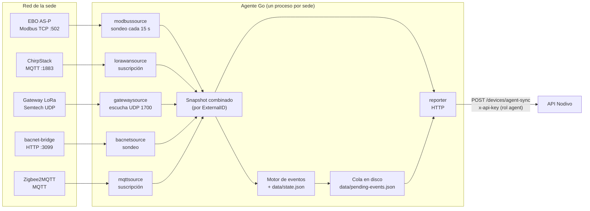
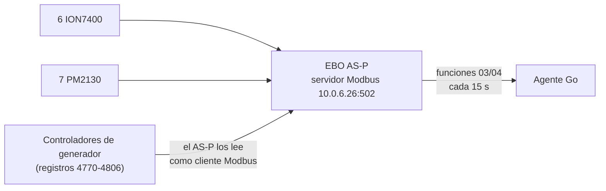

# Agentes Go: manual completo

Estado al **2026-10-12**. Describe lo que funciona hoy, dónde corre, cómo se configura y cómo se
opera. El historial de diseño y las decisiones de arquitectura están en
[`agente-go.md`](./agente-go.md); el detalle de las sedes IGSS, en [`sedes-igss.md`](./sedes-igss.md);
el receptor LoRaWAN sin ChirpStack, en [`lorawan-directo.md`](./lorawan-directo.md).

## Índice

1. [Qué es un agente Go](#1-qué-es-un-agente-go)
2. [Agentes en producción](#2-agentes-en-producción)
3. [Cómo funciona por dentro](#3-cómo-funciona-por-dentro)
4. [Fuentes de datos (protocolos)](#4-fuentes-de-datos-protocolos)
5. [Modbus: EBO AS-P de las sedes IGSS](#5-modbus-ebo-as-p-de-las-sedes-igss)
6. [Eventos y alarmas](#6-eventos-y-alarmas)
7. [Comunicación con la API de Nodivo](#7-comunicación-con-la-api-de-nodivo)
8. [Referencia de `config.yaml`](#8-referencia-de-configyaml)
9. [Operación en el servidor](#9-operación-en-el-servidor)
10. [Compilar, probar y desplegar](#10-compilar-probar-y-desplegar)
11. [Agregar una sede nueva](#11-agregar-una-sede-nueva)
12. [Herramientas auxiliares](#12-herramientas-auxiliares)
13. [Diagnóstico de problemas](#13-diagnóstico-de-problemas)
14. [Problemas conocidos y pendientes](#14-problemas-conocidos-y-pendientes)

---

## 1. Qué es un agente Go

Un **recolector por sede o edificio**. Es un único programa (binario de Go, sin dependencias) que:

1. **Se conecta por su cuenta** a los equipos de la red de la sede: Modbus TCP, MQTT de ChirpStack,
   gateways LoRa, Zigbee2MQTT y BACnet (este último a través de `bacnet-bridge`).
2. **Descubre** los equipos que responden con datos válidos.
3. **Convierte** los valores crudos a unidades reales (V, A, kW, Hz, °C, ppm...).
4. **Detecta eventos** en tiempo real comparando cada lectura con la anterior.
5. **Guarda en disco** lo que no pudo enviar si la API o la red se caen.
6. **Reporta** a la API de Nodivo cada 15-30 s, o al instante si hay un evento crítico.

Reglas que cumple siempre:

- **Solo lectura.** No envía comandos a los equipos. En Modbus usa solo las funciones 03 y 04; no
  existe código para escribir registros.
- **No depende de `api-SIASA`.** El mapa de registros de los equipos IGSS se tomó una vez de ese
  proyecto y vive dentro del agente (`profiles.go` + `config.yaml`).
- **Un agente = una sede.** Cada uno tiene su `buildingKey`, su API key y su carpeta de datos. Si
  uno falla, los demás siguen.

## 2. Agentes en producción

Todos corren en el servidor **192.168.70.4** (Linux, usuario `api`), fuera de Docker, como procesos
nativos.

| Carpeta | `buildingKey` | Fuentes | Sincroniza | Estado al 2026-10-12 |
|---|---|---|---|---|
| `/home/api/agente-go/` | `tec3-nivel10` | LoRaWAN (ChirpStack 192.168.70.6) + BACnet (bridge `127.0.0.1:3099` → AC Smart 5 10.3.0.11) | cada 30 s | Funcionando: 35 equipos, todos ya existían (sin duplicados) |
| `/home/api/agente-go-tec3-oficina/` | `tec3-oficina` | Gateway LoRa directo (UDP `0.0.0.0:1700`) | cada 15 s | **En pausa**: el gateway de pruebas volvió a apuntar a ChirpStack, no recibe tramas |
| `/home/api/agente-go-escuintla/` | `igss-escuintla` | Modbus (EBO AS-P 10.0.6.26) + LoRaWAN (ChirpStack 10.0.6.35) | cada 15 s | Funcionando: 14/15 equipos Modbus + ~120 sensores LoRaWAN |
| `/home/api/agente-go-escuintla-directo/` | `igss-escuintla-directo` | Modbus directo a 12 medidores (Piloto Gravix, Fase B), agente 0.5.5 con `remoteConfig: true` y backlog | cada 30 s | Funcionando (actualizado al 17/11/2026). **No está en el crontab**: no arranca solo si se reinicia el servidor |

> Al 18/11/2026: `bacnet-bridge` está caído desde el 15/11 (sin memoria), así que el agente de TEC 3
> Nivel 10 no recibe datos de los aires. Diagrama general en
> [`arquitectura-general.md`](./arquitectura-general.md).

### Contenido de cada carpeta

| Archivo | Qué es |
|---|---|
| `agente-go` | El programa |
| `config.yaml` | Configuración de la sede. Contiene la API key: permisos `600`, nunca a git |
| `start.sh` (en TEC 3 Nivel 10: `start-agente-go.sh`) | Arranca el agente y lo relanza a los 5 s si se cae |
| `agente.log` (en TEC 3 Nivel 10: `agente-go.log`) | Log del agente |
| `data/pending-events.json` | Eventos aún no enviados a la API |
| `data/state.json` | Estado de las alarmas (activas, contadores, última vez visto) |
| `*.bak-AAAAMMDDHHMM` | Respaldos hechos antes de cada cambio |

### Arranque automático

Por `crontab` del usuario `api` (`crontab -l`):

```
@reboot /home/api/agente-go-escuintla/start.sh
@reboot /home/api/agente-go/start-agente-go.sh
@reboot /home/api/agente-go-tec3-oficina/start.sh
@reboot /home/api/siasa-iot-platform/start-bacnet-bridge.sh
```

### Otros procesos de los que dependen

| Proceso | Dónde | Lo usa |
|---|---|---|
| API Nodivo (Docker `siasa-iot-platform-api-1`) | `localhost:3010/api/v1` | Los 3 agentes |
| `bacnet-bridge` (Node, fuera de Docker) | `127.0.0.1:3099`, script `~/siasa-iot-platform/start-bacnet-bridge.sh` | TEC 3 Nivel 10 |

## 3. Cómo funciona por dentro



Ciclo de vida (código en `internal/agent/agent.go`):

1. Al arrancar, carga `config.yaml`, abre `data/` y arranca **solo las fuentes con `enabled: true`**.
2. Cada fuente entrega su lista completa de equipos cada vez que tiene datos nuevos. El agente la
   mezcla en un **snapshot** único, usando como llave el `ExternalID` de cada equipo.
3. Sobre cada lectura nueva corre el **motor de eventos**. Los eventos se guardan en disco al
   momento.
4. Cada `syncIntervalSeconds` envía el snapshot completo + hasta 500 eventos pendientes. Si hay un
   evento **crítico**, adelanta el envío sin esperar el ciclo.
5. Si la API responde bien, borra de la cola los eventos enviados. Si falla, los conserva y los
   reintenta en el siguiente ciclo (hasta 20 000 eventos en espera).
6. Al detenerse (`SIGTERM`/`Ctrl+C`), guarda el estado de las alarmas, así que reiniciar no duplica
   alarmas ni pierde eventos.

### Identidad de cada equipo (`ExternalID`)

Es lo que hace que la API reconozca a un equipo en cada sync. **No debe cambiar.**

| Fuente | Formato | Ejemplo |
|---|---|---|
| Modbus | `modbus:<host>:<name del config>` | `modbus:10.0.6.26:ANALIZADOR-1` |
| LoRaWAN (ChirpStack) | `lorawan:<devEui>` | `lorawan:24e124...` |
| Gateway LoRa directo | `lora-gateway:<EUI>` | `lora-gateway:0016c001f1de39f9` |
| Sensor escuchado por radio | `lorawan:<devEui>`, `lorawan-addr:<devAddr>` o `lora-radio:<id>` | — |
| BACnet | `bacnet:<host>:<unitKey>` | `bacnet:10.3.0.11:a3` |
| MQTT / Zigbee2MQTT | `mqtt:<friendly_name>` | `mqtt:Dimmer_Oficina3` |

Por eso, en Modbus, **renombrar un equipo en `config.yaml` lo convierte en un equipo nuevo** para
Nodivo.

## 4. Fuentes de datos (protocolos)

| Fuente | Código | Cómo obtiene los datos | Funciona en |
|---|---|---|---|
| **Modbus TCP** | `internal/discovery/modbussource/` | Cliente Modbus propio. Lee bloques de registros cada 15 s (funciones 03/04) | Escuintla |
| **LoRaWAN por ChirpStack** | `internal/discovery/lorawansource/` | Se suscribe al MQTT de ChirpStack, topic `application/+/device/+/event/up` | Escuintla, TEC 3 Nivel 10 |
| **LoRaWAN directo** | `internal/discovery/gatewaysource/` | Recibe al gateway por Semtech UDP (GWMP) en el puerto 1700; descifra con las llaves de cada sensor | TEC 3 Oficina (en pausa) |
| **BACnet** | `internal/discovery/bacnetsource/` | Pide los datos por HTTP a `apps/bacnet-bridge`, que habla BACnet/IP | TEC 3 Nivel 10 |
| **MQTT / Zigbee2MQTT** | `internal/discovery/mqttsource/` | Se suscribe a `<baseTopic>/bridge/devices` y al estado de cada dispositivo | Disponible, sin uso hoy |

### LoRaWAN por ChirpStack

- Cada uplink llega ya decodificado por ChirpStack. El agente reenvía las métricas, el modelo
  (`deviceProfileName`), RSSI/SNR/fCnt y **las etiquetas del dispositivo en ChirpStack** como
  `attributes.tag_*` (área, código, tipo de sensor, umbrales).
- **Las etiquetas de ChirpStack son la configuración de cada sensor.** No hay que tocar código
  para cambiar el nombre, el área o los umbrales de un sensor: se editan sus tags en ChirpStack.
- **Cadena de frío (WISE 4-20 mA):** el agente convierte cada canal a °C con los tags por canal
  (`aiN_multiplier`, `aiN_offset`, `aiN_threshold_min/max`, `aiN_operative_area`, `aiN_code`), y
  usa `aiN_tolerance` como minutos de gracia antes de alarmar. Una lectura pegada al borde de
  4-20 mA se trata como falla de sonda, no como temperatura. Catálogo de fórmulas (cadena de frío,
  bombeo de agua, calentador, caldera) y regla del signo del offset:
  [`formulas-4-20ma.md`](./formulas-4-20ma.md).
- Si ChirpStack se cae, no llega nada: lo detecta el evento `lorawan.site_silent`.

### LoRaWAN directo (sin ChirpStack)

- En el gateway se configura como *Network Server* la IP del servidor del agente, puerto 1700.
- **Solo escucha**: no responde por radio a los sensores (no acepta uniones a la red ni confirma
  mensajes). Por eso, sin ChirpStack, los sensores terminan pidiendo unirse de nuevo y cambian sus
  llaves. Ver [`lorawan-directo.md`](./lorawan-directo.md).
- Sin llaves registra la trama (DevAddr, RSSI, contador). Con llaves (`loraGateway.keys`) valida y
  descifra, y traduce los modelos Milesight LEO-S592, LEO-S595, EM300-TH y EM500-LGT con los
  mismos nombres de métricas que ChirpStack.

### BACnet

El agente no habla BACnet/IP directamente: la librería de Go probada contra el gateway real no
decodificaba sus respuestas. Usa `apps/bacnet-bridge` (Node + bacstack), que ya estaba verificado.
Detalle en [`agente-go.md`](./agente-go.md#por-que-bacnet-no-habla-el-protocolo-directo-en-go).

## 5. Modbus: EBO AS-P de las sedes IGSS

En las sedes IGSS los medidores no se leen uno por uno. Todos están conectados al **EBO AS-P de
Schneider**, que concentra sus datos y los publica en **su propio servidor Modbus TCP** (unit 1),
cada equipo en un bloque fijo de registros. El agente se conecta a ese servidor.



### Mapa de registros (Escuintla)

Numeración del EBO: el registro N es la dirección Modbus N-1.

| Equipo | Registro inicial | Largo | Perfil |
|---|---|---|---|
| PM2130-1 … PM2130-7 | 101, 123, 145, 167, 189, 211, 233 | 22 | `pm2130` |
| ANALIZADOR-1 (ION7400) | 255 | 70 | `ion7400` |
| ANALIZADOR-2 … 6 (ION7400) | 325, 399, 473, 547, 621 | 74 | `ion7400-b` |
| Generador Planta Hospital | 5705 | 38 | `generator` |
| Generador Módulos | 5743 | 38 | `generator` |
| Estado S1/S2 del ATS (ANALIZADOR-1 / -5) | 695/697 y 587/589 | 1 c/u | `extra` |
| Contadores de transferencias del ATS | 5781/5783 y 5785/5787 | 1 c/u | `extra` |

### Perfiles (`internal/discovery/modbussource/profiles.go`)

| Perfil | Contenido | Codificación |
|---|---|---|
| `pm2130` | Voltajes L-N y L-L, corrientes A/B/C, frecuencia, demanda total (11 valores) | float32 ABCD; si sale 0 o inválido, prueba CDAB |
| `ion7400` | Potencia activa/aparente por fase y total, demanda pico, corrientes, FP, frecuencia, flicker Pst, THD de corriente y voltaje, voltajes (35 valores) | float32 ABCD/CDAB. THD y flicker con **escala autodetectada** (el EBO los entrega con escala variable) |
| `ion7400-b` | Igual que `ion7400`, pero con 2 registros reservados antes de la calidad de energía | Igual |
| `generator` | kVA y kW por fase y total, FP, frecuencias, velocidad, carga, refrigerante, aceite, batería, combustible (19 valores) | int32/uint32 con la palabra baja primero (CDAB) y uint16. **Escala ×1** |

**Escala del generador:** el AS-P copia uno a uno los 19 puntos que lee del controlador (registro
4770 → 5705, 4772 → 5707, …) y los publica **como enteros ya en unidades reales, sin decimales**.
Comprobado el 2026-10-12 contra la vista del AS-P: batería 26.50 V → crudo 26; PF 16.26 → 16;
refrigerante 15.80 °C → 14. Hasta ese día el agente aplicaba ×0.01 (tomado de `api-SIASA`, que
nunca leyó los generadores) y mostraba 0.26 V.

### Lectura y “autodescubrimiento”

Modbus no permite preguntar qué equipos existen. En cada ciclo el agente:

1. Lee cada bloque configurado con la función 03. Si da excepción o todo en cero, prueba la 04.
2. Decodifica con el perfil y **valida** que los valores tengan sentido:
   - PM2130: algún voltaje de fase entre 50 y 300 V (o de línea entre 80 y 500 V) y frecuencia entre
     40 y 80 Hz.
   - ION7400: frecuencia entre 40 y 80 Hz, o potencia, corriente o voltaje distintos de 0.
   - Generador: batería entre 5 y 60 V, o cualquier valor distinto de 0.
3. Si no valida, prueba los `startCandidates` (se usa en PM2130-7).
4. Reporta solo los equipos válidos. Uno ya visto que deja de responder pasa a `offline`.
5. Espera `readDelayMs` (50 ms) entre lecturas para no saturar el EBO, que también lee el sistema
   anterior.

El log lo resume en cada ciclo: `[modbus] EBO-ASP-ESCUINTLA: 14/15 equipo(s) con datos validos`.
Hoy el que falta es **Generador Módulos**: su bloque está todo en 0 dentro del EBO.

## 6. Eventos y alarmas

Código: `internal/events/`. El agente evalúa cada lectura en el momento en que llega, así ve
cambios que duran segundos (una puerta, una transferencia corta del ATS). La API solo guarda una
lectura por minuto.

Las alarmas tienen estado: emiten un evento al **entrar** en condición y otro al **salir**
(“normalizado”), nunca uno por lectura.

### Catálogo

| Tipo | Severidad | Cuándo |
|---|---|---|
| `energy.source_generator` / `energy.source_commercial` | crítico / info | El ATS pasa a generador o regresa a comercial (registros S1/S2) |
| `energy.generator_transfer_counted` | aviso | Sube el contador de transferencias del vigilante del ATS |
| `power.phase_loss` / `power.phase_restored` | crítico / info | Una fase cae por debajo del `phaseLossPct` de la mayor |
| `power.voltage_out_of_range` / `power.voltage_normal` | aviso / info | Voltaje fuera de nominal ± tolerancia |
| `power.frequency_out_of_range` / `power.frequency_normal` | aviso / info | Frecuencia fuera de `frequencyMin`–`frequencyMax` |
| `power.thd_high` / `power.thd_normal` | aviso / info | THD de voltaje > `thdVoltageMaxPct` (solo ION7400) |
| `power.overload` / `power.load_normal` | aviso / info | kVA > `overloadPct` de `capacityKva` (solo ION7400) |
| `generator.no_data` / `generator.data_restored` | aviso / info | La batería del generador no supera 5 V: el EBO no tiene datos del controlador. Mientras dure, no se evalúan las demás reglas del generador |
| `generator.started` / `generator.stopped` | aviso / info | Velocidad > `generatorRunningRpm` |
| `generator.fuel_low` / `generator.fuel_ok` | crítico / info | Combustible < `generatorFuelMinPct` |
| `generator.battery_low` / `generator.battery_ok` | aviso / info | Batería < `generatorBatteryMinV` |
| `generator.coolant_high` / `generator.coolant_ok` | crítico / info | Refrigerante > `generatorCoolantMaxC` |
| `door.opened` / `door.closed` | info | Cambio del sensor de puerta |
| `door.open_too_long` / `door.open_too_long_cleared` | aviso / info | Abierta más de `doorOpenMaxMinutes` |
| `door.tamper` / `door.tamper_cleared` | crítico / info | Sabotaje del sensor |
| `air.co2_high` / `air.co2_normal` | aviso / info | CO₂ > umbral (tag `threshold_max` con unidad ppm, o `co2MaxPpm`) |
| `env.temperature_high` / `env.temperature_low` / `env.temperature_normal` | aviso / info | Fuera de los umbrales del sensor (tags) o de `temperatureMin/Max` |
| `coldchain.out_of_range` / `coldchain.normal` | crítico / info | Refrigerador o congelador fuera de su rango (`aiN_threshold_min/max`) por más de `aiN_tolerance` **minutos** (para que abrir la puerta un momento no sea alarma) |
| `water.pressure_low` / `water.pressure_high` / `water.pressure_normal` | aviso / info | Presión del bombeo de agua (canal `water_pressure`) fuera de su rango por más de `aiN_tolerance` minutos |
| `process.out_of_range` / `process.normal` | aviso / info | Calentador, caldera u otro canal 4-20 mA que no es cadena de frío, fuera de su rango |
| `io.sensor_fault` / `io.sensor_ok` | aviso / info | Entrada 4-20 mA en el límite de escala: sonda desconectada o dañada |
| `io.open_circuit` / `io.open_circuit_cleared` | aviso / info | Entrada en circuito abierto |
| `io.out_of_range` / `io.in_range` | aviso / info | Entrada fuera de 4-20 mA |
| `sensor.battery_low` / `sensor.battery_ok` | aviso / info | Batería del sensor LoRaWAN < `batteryMinPct` |
| `device.offline` / `device.online` | crítico (generador, ION7400, gateway) o aviso / info | Equipo sin datos; sensor LoRaWAN sin uplinks por más de `sensorStaleMinutes` |
| `lorawan.site_silent` / `lorawan.site_restored` | crítico / info | Ningún sensor LoRaWAN reporta en `siteSilentMinutes`: ChirpStack, gateway o broker caído |
| `discovery.gateway` / `discovery.radio_device` | info | Primera vez que aparece un gateway o un dispositivo por radio (LoRaWAN directo) |
| `lorawan.join_request` | info | Un sensor pide unirse a la red (LoRaWAN directo) |

### Umbrales por defecto

Se cambian por sede en `config.yaml`, sección `events.thresholds`. Un valor omitido o en 0 usa el
default.

| Umbral | Default | Umbral | Default |
|---|---|---|---|
| `nominalVoltage` | 120 V | `generatorFuelMinPct` | 25 % |
| `voltageTolerancePct` | 10 % | `generatorBatteryMinV` | 24 V |
| `frequencyMin` / `frequencyMax` | 59.5 / 60.5 Hz | `generatorCoolantMaxC` | 95 °C |
| `thdVoltageMaxPct` | 8 % | `co2MaxPpm` | 1000 ppm |
| `overloadPct` | 80 % | `batteryMinPct` | 20 % |
| `phaseLossPct` | 50 % | `doorOpenMaxMinutes` | 10 min |
| `generatorRunningRpm` | 100 RPM | `sensorStaleMinutes` | 60 min |
| `temperatureMin` / `temperatureMax` | 0 / 0 (desactivado) | `siteSilentMinutes` | 15 min |

Más detalle y cómo agregar reglas: `docs/procedimientos/eventos-sede.md`.

## 7. Comunicación con la API de Nodivo

| Endpoint | Quién lo usa | Para qué |
|---|---|---|
| `POST /devices/agent-sync` (header `x-api-key`) | Agente | Envía `buildingKey`, versión, la lista de equipos y los eventos pendientes |
| `GET /devices/agent-status` | Web | Último sync de cada sede, con el conteo por protocolo |
| `GET /devices` | Web | Equipos y su último estado (`metadata.agent.buildingKey` indica la sede) |
| `GET /devices/:id/history?range=1h\|24h` | Web | Historial de un equipo (máximo 1 lectura por minuto) |
| `GET /sites/:buildingKey/events` | Web | Historial de eventos de la sede |
| `GET /agents` | Web | Agentes conocidos: versión de config guardada/aplicada y último sync |
| `GET/PUT /agents/:buildingKey/config` | Web (PUT solo admin) / Agente | Config remota de protocolos (ver sección 8.1) |
| `POST /agents/:buildingKey/config/seed` | Agente | Primera conexión: sube los protocolos de su `config.yaml` como v1 |
| `GET /agents/:buildingKey/control` | Agente, cada 5 s | Versión vigente y escaneo pendiente |
| `POST /agents/:buildingKey/config/applied` | Agente | Avisa qué versión quedó corriendo (o por qué la rechazó) |
| `POST/GET /agents/:buildingKey/scan` | Web (admin u operador) | Pide y lee una búsqueda de equipos en la red de la sede |
| `POST /agents/:buildingKey/scan/:id/result` | Agente | Sube el avance y el resultado de la búsqueda |

Qué hace la API con cada equipo del sync:

1. Si ya es de ese agente (`buildingKey` + `externalId`), actualiza su estado.
2. Si no, busca si ya existe por otra vía (mismo topic MQTT, mismo DevEUI o mismo host+unidad
   BACnet). Si existe, **no lo toca** y lo cuenta en `ya-existian`. Así el agente de TEC 3 Nivel 10
   no duplica los AC ni los sensores que ya estaban.
3. Si no existe, lo crea con `pendingReview: true` y sin área.
4. Los eventos se guardan sin duplicar: cada uno trae un id único generado por el agente.

**API key:** cada agente usa una key propia con rol `agent`, que solo puede llamar a `agent-sync`
y a lecturas. Keys activas:

| Nombre | Agente |
|---|---|
| Agente TEC3 (servidor) | TEC 3 Nivel 10 |
| Agente TEC3 Oficina (LoRa directo) | TEC 3 Oficina |
| Agente IGSS Escuintla (servidor) | Escuintla (creada el 2026-10-12) |

La key vieja "Agente IGSS Escuintla" está revocada desde el 2026-10-10.

En **Sedes → Sensores LoRaWAN**, los WISE se agrupan por propósito según el `aiN_type` de sus
canales (el mismo equipo se usa para cosas distintas):

- **Cadena de frío** (`temperature`): una tarjeta por WISE con un dibujo por refrigerador o
  congelador. Sus **sensores de puerta LEO S595 se asocian por código** (tag `code` de la puerta =
  `aiN_code` del canal, ej. `HES010`) y se muestran dentro del equipo: 1 o 2 puertas que se abren
  en el dibujo cuando el sensor reporta "abierta", con batería y aviso de sabotaje. Esas puertas ya
  no aparecen en la sección "Puertas"; ahí quedan solo las que no tienen equipo asociado.
- **Bombeo de agua** (`water_pressure`) y **Calderas y calentadores** (`water_heater_temperature`):
  un dial de aguja por canal, con la escala del transmisor (valor a 4 y a 20 mA) y la franja verde
  del rango permitido.

- **Calidad de aire (LEO S592)**: el equipo se dibuja como el real (pantalla de tinta electrónica
  con fecha/hora, CO₂ con gráfica 200-1500 ppm, carita de confort, PM2.5/PM10, temperatura y
  humedad; LED ámbar si el CO₂ supera su límite). La gráfica solo usa datos reales: en la vista
  normal se llena con las lecturas que llegan; al resaltarlo carga el historial de CO₂ de la
  última hora.
- **Resaltado 3D**: clic en un refrigerador/congelador o en un LEO S592 lo levanta en perspectiva
  (costado y techo visibles, sombra, flotación). Otro clic o Esc lo regresa. Se desactiva la
  animación si el usuario pidió "reducir movimiento".

En la web, la pestaña **Sedes** muestra cada sede. Si una sede no tiene ningún equipo real,
muestra **datos de demostración** con un aviso azul: si ves ese aviso, el agente de esa sede no
está reportando.

## 8. Referencia de `config.yaml`

Plantillas en el repo: `apps/Agente_Go/config.example.yaml` (genérica),
`config.igss-escuintla.example.yaml` y `config.tec3-oficina.example.yaml`.

```yaml
buildingKey: "igss-escuintla"     # obligatorio y estable: cambiarlo = todos los equipos "nuevos"

api:
  baseUrl: "http://localhost:3010/api/v1"   # obligatorio
  apiKey: "siasa_..."                        # obligatorio, rol agent

syncIntervalSeconds: 15           # default 30
dataDir: "/home/api/agente-go-escuintla/data"   # default ./data

events:
  enabled: true                   # default true
  maxPending: 20000               # default 20000
  thresholds: { ... }             # ver sección 6

modbus:
  enabled: true
  name: "EBO-ASP-ESCUINTLA"       # para logs; default = host
  host: "10.0.6.26"               # obligatorio si enabled
  port: 502                       # default 502
  unitId: 1                       # default 1
  pollIntervalSeconds: 15         # default 15
  timeoutMs: 10000                # default 8000
  readDelayMs: 50                 # default 50
  devices:
    - name: "ANALIZADOR-1"        # estable: forma parte del ExternalID
      profile: ion7400            # ion7400 | ion7400-b | pm2130 | generator
      start: 255                  # registro inicial (numeración del EBO)
      startCandidates: [ ... ]    # opcional: inicios alternativos
      extra:                      # opcional: registros sueltos de 16 bits
        - { key: s1_commercial_energy_status, register: 695 }
      attributes:                 # se reenvían tal cual a Nodivo
        { area: "Cuarto eléctrico", code: "HES107", phase: "Trifásica", capacityKva: 300 }

lorawan:                          # ChirpStack
  enabled: true
  brokerUrl: "tcp://10.0.6.35:1883"
  username: ""
  password: ""

loraGateway:                      # LoRaWAN directo
  enabled: false
  listen: ":1700"                 # default :1700
  gatewayTimeoutSeconds: 90       # default 90
  maxRadioDevices: 300            # default 300
  keys:                           # llaves por sensor (exportables con chirpstack-keys)
    - { name, model, devEui, devAddr, nwkSKey, appSKey, appKey, fCntUp, attributes }

bacnet:
  enabled: false
  bridgeUrl: "http://127.0.0.1:3099"
  bridgeToken: "..."
  pollIntervalSeconds: 15         # default 15
  devices:
    - { name: "AC Smart 5", host: "10.3.0.11" }

mqtt:                             # Zigbee2MQTT
  enabled: false
  brokerUrl: "tcp://..."
  baseTopic: "zigbee2mqtt"        # default
```

Atributos que la web usa en Modbus: `area`, `code`, `phase` (`Trifásica`/`Monofásica`; en
monofásicos no se evalúa la fase C), `capacityKva` (para el % de carga del ION7400), `generator` y
`feeds`.

`modbus:` (un servidor) sigue funcionando. Para varios servidores Modbus en la misma sede se usa
`modbusServers:` (una lista con los mismos campos); el agente convierte `modbus:` en el primer
elemento de esa lista.

### 8.1 Configuración desde la web (config remota, agente 0.5.0 o superior)

Los protocolos (`mqtt`, `lorawan`, `bacnet`, `modbus`/`modbusServers`, `loraGateway`) se editan en
la web: **Panel de dispositivos → pestaña Configuración**. En el `config.yaml` del servidor solo
hacen falta `buildingKey`, `api`, `dataDir`, `syncIntervalSeconds` y `events`.

- **Primera vez:** si la API no tiene config para ese `buildingKey`, el agente sube las secciones de
  protocolo de su `config.yaml` como **v1**. Desde ahí la fuente de verdad es la API; las secciones
  del archivo ya no se usan (salvo el caso de abajo).
- **Cambios:** cada "Guardar y enviar al agente" crea una versión nueva. El agente consulta
  `GET /agents/:buildingKey/control` cada 5 s, descarga la versión nueva y **reinicia solo las
  secciones que cambiaron** (si cambia el puerto Modbus, LoRa y MQTT siguen sin cortes). Avisa con
  `config/applied`; la web muestra el avance: guardada → descargada → aplicada.
- **Config inválida:** el agente la rechaza, sigue con la anterior y la web muestra el motivo.
- **Una fuente no arranca** (broker caído, bridge apagado, puerto UDP ocupado): la versión queda
  aplicada "con problemas", el resto funciona y esa fuente se reintenta cada minuto.
- **API caída al arrancar:** usa la última config remota guardada en `dataDir/remote-config.json`
  (tiene contraseñas y llaves: permisos 600). Si no hay copia, usa las secciones de `config.yaml`.
- **Desactivar:** `remoteConfig: false` en `config.yaml` = solo el archivo, como antes de la 0.5.0.
- **Secretos:** la web recibe contraseñas, token del bridge y llaves LoRa enmascaradas (`********`);
  si no se tocan, se conserva el valor guardado. Solo la API key del agente las recibe completas.
- **Optimista:** si dos personas editan a la vez, el segundo "Guardar" recibe 409 y debe recargar.

**Buscar dispositivos en la red.** En cada tarjeta se escribe dónde buscar (IP, rango `10.0.6.1-50`
o red `10.0.6.0/24`, de /16 a /32, máximo 1024 IP por protocolo). El agente:

- **Modbus:** abre TCP al puerto (700 ms) y, si responde, lee 1 registro con la función 03 en cada
  unit ID pedido (por defecto 1-10, máximo 32). Las excepciones de gateway 0x0A/0x0B cuentan como
  "no hay equipo"; cualquier otra respuesta, como "hay equipo".
- **BACnet:** pide al bridge `POST /who-is` (Who-Is unicast a cada IP, espera 5 s los I-Am). Hace
  falta el bridge actualizado.
- **Brokers MQTT (ChirpStack, Zigbee2MQTT):** prueba la conexión TCP ("Probar conexión desde el agente").

Solo lecturas: no escribe registros ni envía comandos. Un equipo encontrado se agrega con
**Agregar**. Para que un servidor Modbus nuevo empiece a leer hay que cargar sus equipos (perfil y
registro inicial), igual que en el `config.yaml`; ver `docs/procedimientos/sede-igss.md`.

## 9. Operación en el servidor

Entrar: `ssh api@192.168.70.4`. Los ejemplos usan Escuintla; para otro agente cambia la carpeta.

> **No uses `pkill -f agente-go` ni `pgrep -f`**: hay 3 agentes con el mismo nombre de programa y
> también coincidiría con tu propia sesión SSH. Identifica cada proceso por su carpeta, como abajo.

### Ver qué agentes están corriendo

```bash
for p in $(pgrep -x agente-go); do echo "$p $(readlink /proc/$p/cwd)"; done
```

### Ver el log

```bash
tail -f /home/api/agente-go-escuintla/agente.log
grep "modbus\]" /home/api/agente-go-escuintla/agente.log | tail -5
grep "\[evento\]" /home/api/agente-go-escuintla/agente.log | tail -20
```

Lo normal: `[modbus] ... 14/15 equipo(s) con datos validos` y `sync OK: ...` en cada ciclo.

### Reiniciar un agente

Mata solo el proceso del agente; su `start.sh` lo relanza en 5 s:

```bash
D=/home/api/agente-go-escuintla
for p in $(pgrep -x agente-go); do [ "$(readlink /proc/$p/cwd)" = "$D" ] && kill $p; done
sleep 8; tail -5 $D/agente.log
```

### Detenerlo por completo

```bash
D=/home/api/agente-go-escuintla
for p in $(pgrep -x start.sh); do grep -q agente-go-escuintla /proc/$p/cmdline && kill $p; done
for p in $(pgrep -x agente-go); do [ "$(readlink /proc/$p/cwd)" = "$D" ] && kill $p; done
crontab -l | grep -v agente-go-escuintla | crontab -    # opcional: que no arranque al reiniciar
```

### Arrancarlo

Primero confirma que no esté corriendo (si no, quedan dos agentes de la misma sede):

```bash
nohup /home/api/agente-go-escuintla/start.sh >/dev/null 2>&1 &
(crontab -l; echo "@reboot /home/api/agente-go-escuintla/start.sh") | sort -u | crontab -
```

### Cambiar la configuración

Con el agente 0.5.0 o superior, los protocolos se cambian en la web (sección 8.1), sin entrar al
servidor ni reiniciar. Lo de abajo es solo para `buildingKey`, `api`, `dataDir` y `events`, o para
agentes con `remoteConfig: false`:

```bash
cd /home/api/agente-go-escuintla
cp config.yaml config.yaml.bak-$(date +%Y%m%d%H%M)
nano config.yaml
```

Después reinicia el agente.

### Cambiar la API key

1. Crear la key nueva (como admin):
   ```bash
   curl -X POST http://localhost:3010/api/v1/api-keys \
     -H "Authorization: Bearer <JWT de admin>" -H "Content-Type: application/json" \
     -d '{"name":"Agente <sede> (servidor)","role":"agent"}'
   ```
   La respuesta muestra la key **una sola vez**.
2. Ponerla en `api.apiKey` de `config.yaml` y reiniciar el agente.
3. Revocar la anterior con `DELETE /api/v1/api-keys/<id>`.

### Docker no afecta a los agentes

Los agentes no están en Docker. Reiniciar la API (`docker compose restart api`, desde
`~/siasa-iot-platform`) no los detiene: mientras la API no responde, guardan los eventos en disco y
los envían cuando vuelve. No uses `docker compose restart` sin nombre de servicio: reinicia también
la base de datos.

## 10. Compilar, probar y desplegar

En la PC de desarrollo no hay Go instalado. Se usa un Go portátil (descargado en una carpeta
temporal) o Docker:

```bash
cd apps/Agente_Go
go vet ./... && go test ./...

# Binario para el servidor (Linux)
GOOS=linux GOARCH=amd64 CGO_ENABLED=0 go build -trimpath -ldflags "-s -w" -o agente-go-linux ./cmd/agent

# Sin Go local, con Docker:
docker run --rm -v "$(pwd)":/app -w /app -e GOOS=linux -e GOARCH=amd64 -e CGO_ENABLED=0 \
  golang:1.24 go build -o agente-go-linux ./cmd/agent
```

Desplegar en un agente:

```bash
# 1. Copiar el binario nuevo al lado del actual
scp agente-go-linux api@192.168.70.4:/home/api/agente-go-escuintla/agente-go.new

# 2. En el servidor: respaldar, reemplazar y reiniciar
D=/home/api/agente-go-escuintla; cd $D
cp agente-go agente-go.bak-$(date +%Y%m%d%H%M)
chmod +x agente-go.new
for p in $(pgrep -x agente-go); do [ "$(readlink /proc/$p/cwd)" = "$D" ] && kill $p; done
mv -f agente-go.new agente-go
sleep 20; tail -10 agente.log
```

Para volver atrás, copia el `agente-go.bak-...` sobre `agente-go` y reinicia.

Versiones desplegadas al 2026-10-12:

| Agente | Binario |
|---|---|
| Escuintla | 2026-10-12 23:28 UTC: escala ×1 del generador, WISE de bombeo/calderas con su unidad y alarmas, conserva las entradas analógicas entre tramas (**sin commit aún**) |
| TEC 3 Oficina | 2026-10-10 01:03 UTC: decodificador Milesight, client id MQTT único |
| TEC 3 Nivel 10 | 2026-09-29: versión anterior a Modbus, eventos y client id único |

## 11. Agregar una sede nueva

Procedimiento detallado: `docs/procedimientos/sede-igss.md`. En resumen:

1. **Escanear el EBO de la sede en solo lectura** con los scripts de
   `docs/procedimientos/scripts/` para ubicar los bloques:
   ```bash
   node scan-ebo.js <ip-ebo> 1 6000 100      # rangos con datos
   node raw-registers.js <ip-ebo> 101 22 3   # valores crudos de un bloque
   ```
2. Copiar `config.igss-escuintla.example.yaml` como `config.igss-<sede>.yaml` y cambiar
   `buildingKey`, IPs y la lista de `modbus.devices`.
3. Agregar la sede a `apps/web/src/config/sites.ts` con el mismo `buildingKey`.
4. Crear su API key y su carpeta `/home/api/agente-go-<sede>/` (binario, config, `start.sh`,
   crontab), siguiendo la sección 9.
5. Verificar: el log debe decir `N/M equipo(s) con datos validos`; en Sedes, valores plausibles
   (≈120-127 V, ≈60 Hz) y sin el aviso de demostración. Comparar algunos valores contra el propio
   EBO.

## 12. Herramientas auxiliares

| Herramienta | Para qué |
|---|---|
| `cmd/chirpstack-keys` | Exporta, en solo lectura, las llaves de los sensores desde ChirpStack y genera el bloque `loraGateway.keys` del config |
| `cmd/lora-sniffer` | Escucha en solo lectura las tramas crudas del gateway en el broker de ChirpStack, las decodifica y las compara con lo que reporta ChirpStack. `-replay-to` las reenvía a un agente como si fuera un gateway (pruebas) |
| `docs/procedimientos/scripts/scan-ebo.js` | Escaneo de solo lectura del mapa de registros de un EBO |
| `docs/procedimientos/scripts/raw-registers.js` | Muestra los registros crudos de un bloque, decodificados en ABCD y CDAB |

## 13. Diagnóstico de problemas

| Síntoma | Causa probable | Qué revisar |
|---|---|---|
| Sedes muestra “Datos de demostración” | El agente de la sede no está corriendo o la API rechaza su key | Que el proceso exista (sección 9); en el log, errores 401 → key revocada o equivocada |
| `error sincronizando con la API` en el log | API caída o key inválida | `docker ps`; la key en `config.yaml`. Los eventos esperan en `data/` |
| `[modbus] ... 0/15` | El EBO no responde o la red no llega | `nc -zv 10.0.6.26 502`; el log muestra el error de cada equipo |
| Un equipo Modbus no aparece | Su bloque no pasa la validación (todo en 0) | `raw-registers.js` sobre su bloque |
| Un valor sale raro (0, escala ×100…) | Puede venir así del propio EBO | Leer el registro crudo con funciones 03 y 04 y compararlo con la vista del AS-P antes de cambiar código |
| `lorawan.site_silent` | ChirpStack, el gateway o el broker caído | Conexión al broker en el log (`[lorawan] conectado ...`) |
| Dos agentes se desconectan uno al otro en ChirpStack | Mismo client id MQTT | Usar un binario con client id único (desde el 2026-10-10) y no correr la misma sede en dos lugares |
| `sync omitido: todavia no se descubrio ningun dispositivo` | Ninguna fuente trajo datos | Normal en TEC 3 Oficina mientras el gateway apunta a ChirpStack |

## 14. Problemas conocidos y pendientes

**Riesgos de operación**

- **El arranque de TEC 3 Nivel 10 puede no ocurrir tras reiniciar el servidor.**
  `start-agente-go.sh` termina sin hacer nada si encuentra **cualquier** proceso `agente-go`
  (`pgrep -x agente-go`). Ahora hay tres agentes con ese nombre: si al arrancar el servidor alguno
  de los otros sube primero, el de TEC 3 Nivel 10 no arranca. Corrección propuesta: que ese
  chequeo mire solo su propia carpeta.
- **Tres copias del binario con versiones distintas.** Propuesta: un binario compartido y un
  servicio `systemd` por sede (requiere `sudo`).
- **El agente de Escuintla corre en el servidor central**, no en la sede. Si se corta el enlace a
  la red 10.0.6.x, Escuintla deja de reportar.

**Datos de Escuintla que vienen así del EBO** (no son errores del agente)

- ANALIZADOR-2: corriente de la fase A en 0 aunque marca ~105 kW (0 con funciones 03 y 04).
- Generador Planta Hospital: sin decimales; combustible 0 % (alarma crítica activa, confirmar el
  sensor en sitio); FP 16 (valor imposible que reporta el controlador).
- Generador Módulos: bloque 5743-5780 todo en 0.

**Funcionalidad pendiente**


- LoRaWAN directo: responder por radio (aceptar uniones, confirmar mensajes) para no depender de
  ChirpStack.
- Leer los controladores de generador directo por su IP (más precisión y el Generador Módulos).
- Canal de comandos de vuelta para BACnet desde el agente.
- Adaptadores HTTP por fabricante (Shelly, Tasmota).
