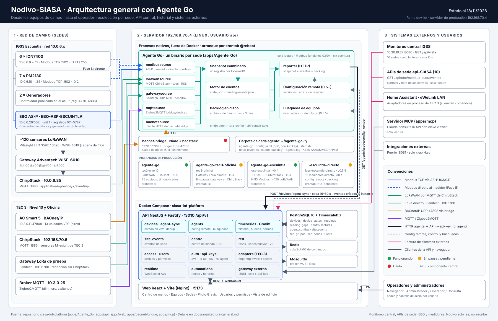
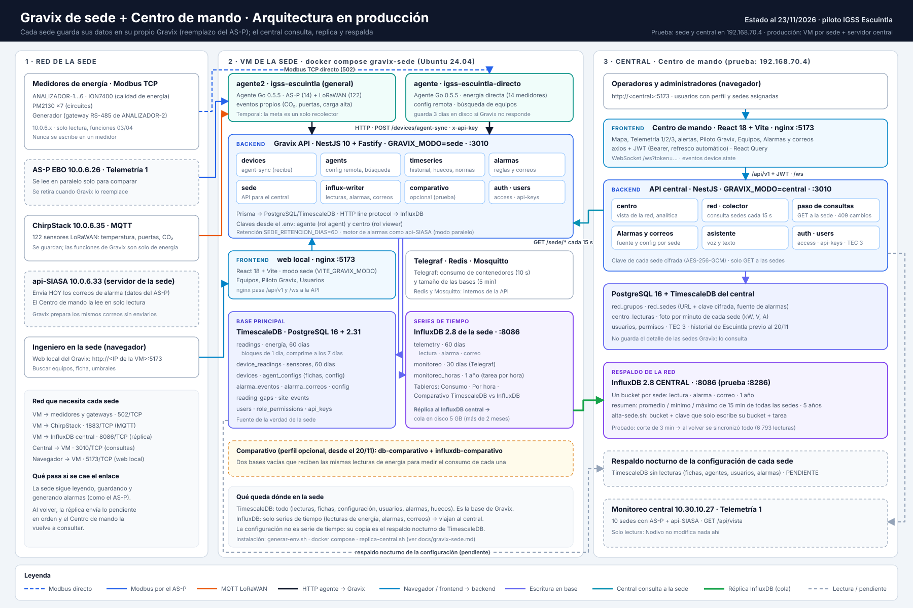
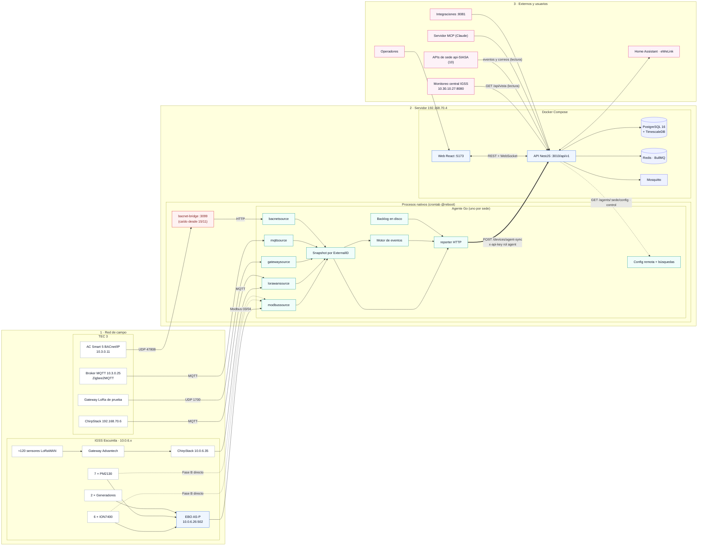
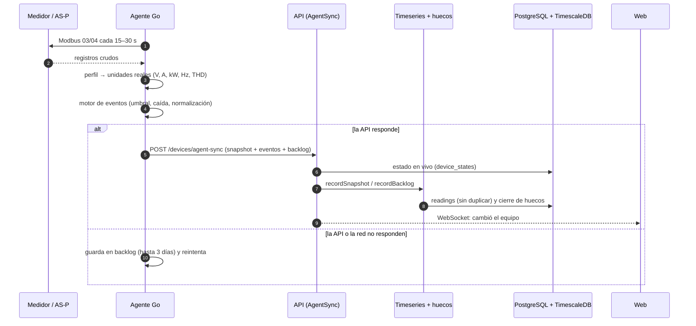
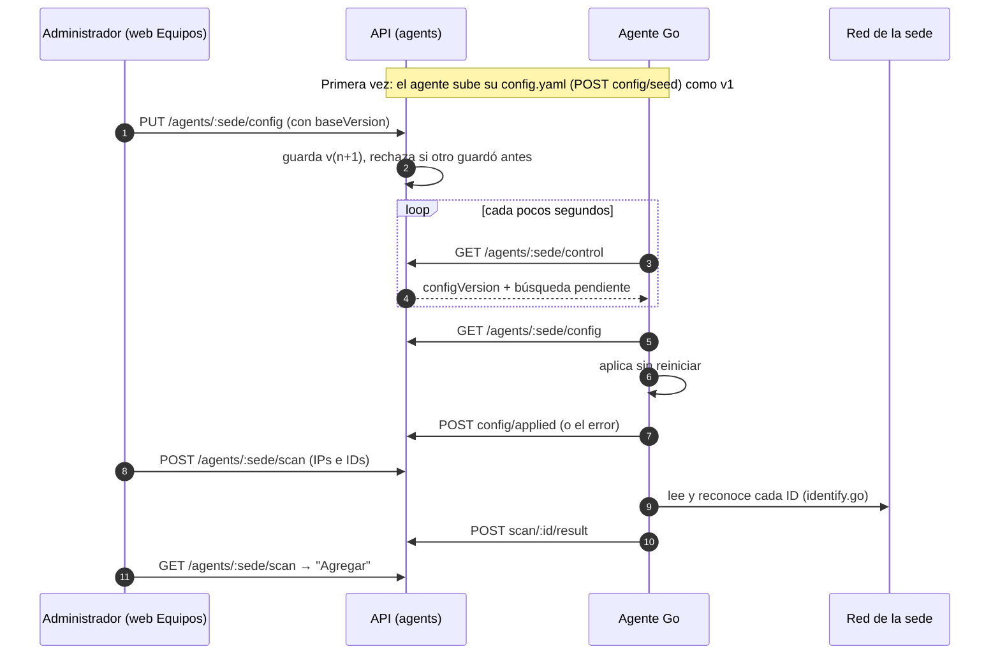
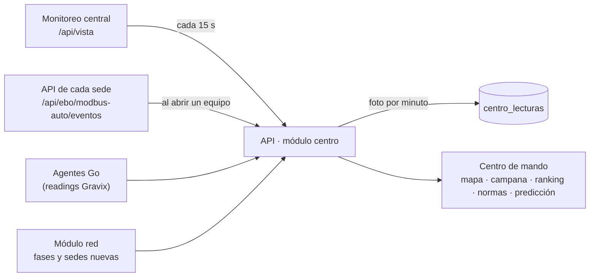

# Arquitectura general de Nodivo-SIASA con Agente Go

Estado al **23/11/2026** (rama `dev-iot`, servidor de **pruebas** 192.168.70.4).

Este es el documento maestro: muestra en una sola vista cómo se relacionan los equipos de campo, los
Agentes Go, la API, las bases de datos, la web y los sistemas externos. Al final hay una bitácora de
todo lo construido desde el 09/09/2026. El detalle de cada pieza está en los documentos enlazados.

> **Desde el 20/11, Escuintla funciona en su Gravix de sede** y la arquitectura de producción es
> "una VM con Gravix por sede + un central". Ver la [sección 1.1](#11-arquitectura-en-producción-gravix-de-sede--central-desde-el-2011).
> La lista completa de endpoints está en [api-referencia.md](./api-referencia.md).

Archivos del diagrama general (estado del 18/11, un solo servidor): [SVG editable](./diagramas/arquitectura-general.svg) ·
[PNG en alta resolución](./diagramas/arquitectura-general.png). Diagrama de producción (23/11):
[gravix-produccion.svg](./diagramas/gravix-produccion.svg) · [PNG](./diagramas/gravix-produccion.png).

---

## 1. Idea en una frase

Cada sede tiene un **Agente Go** que lee sus equipos (Modbus, LoRaWAN, BACnet, MQTT) **sin escribir
nada en ellos**. Ese agente le manda todo a una **API central** (NestJS) por una sola conexión HTTP
saliente. La API guarda el estado en vivo y el historial en **PostgreSQL + TimescaleDB**, detecta
huecos y eventos, y lo muestra en la **web** (Centro de mando, Equipos, Sedes, Piloto Gravix). Además,
la API **lee**, sin modificarlos, el monitoreo central del IGSS y las APIs de cada sede, para juntar
todo en una sola aplicación.

### 1.1 Arquitectura en producción: Gravix de sede + central (desde el 20/11)

- **En cada sede:** una VM Linux con Docker (`deploy/gravix-sede`) con los Agentes Go, el **backend**
  Gravix API (NestJS, `GRAVIX_MODO=sede`), el **frontend** web local (React + nginx), **TimescaleDB**
  (base principal), **InfluxDB** (series de tiempo) y Telegraf. La sede funciona sola aunque se caiga
  el enlace, como el AS-P.
- **En el central:** el **Centro de mando** (la misma API en `GRAVIX_MODO=central` y la misma web), su
  **PostgreSQL + TimescaleDB** y el **InfluxDB central**, que recibe la réplica de todas las sedes.

**Bases de datos** (detalle completo en [gravix-arquitectura.md §0.2](./gravix-arquitectura.md#02-bases-de-datos)):

| Base | Dónde | Qué guarda | Retención |
| --- | --- | --- | --- |
| TimescaleDB de la sede | VM de la sede | Todo: lecturas, fichas, configuración de agentes, usuarios, alarmas, correos, huecos, eventos | Detalle 60 días |
| InfluxDB de la sede | VM de la sede | `telemetry`: lecturas de energía, alarmas y correos; `monitoreo`: consumo de la VM | 60 días · 30 días |
| **InfluxDB central** | Central | Réplica de cada sede (un bucket por sede) + `resumen` de 15 min de toda la red | 1 año · 5 años |
| PostgreSQL + TimescaleDB del central | Central | Red y sedes (URL, clave cifrada, fuente de alarmas), foto por minuto, usuarios, TEC 3 | — |
| Comparativo (opcional) | VM de la sede | Mismas lecturas en TimescaleDB e InfluxDB vacíos, para medir su consumo | Prueba |

**Cómo se comunican el frontend y el backend:**
- La web llama a la API por **REST** (`/api/v1`) con `axios` y **JWT**; el token se renueva solo.
- Recibe cambios en **tiempo real** por **WebSocket** `/ws`.
- Los agentes envían por HTTP con `x-api-key`.
- El central **consulta** a cada sede cada 15 s y le **pasa las consultas** de sus pantallas (solo GET).
- El InfluxDB de cada sede **replica** al InfluxDB central, con cola en disco.

Explicación detallada en [gravix-arquitectura.md §0.3](./gravix-arquitectura.md#03-backend-frontend-y-cómo-se-comunican).

## 2. Diagrama por capas (Mermaid, editable)

## 3. Componentes

### 3.1 Agente Go (`apps/Agente_Go`)

Binario de Go sin dependencias, **uno por sede**. Corre en el servidor como proceso nativo (fuera de
Docker) y se relanza solo si se cae (`start.sh`).

| Paquete | Qué hace |
| --- | --- |
| `cmd/agent` | Programa principal |
| `cmd/lora-sniffer` | Herramienta de diagnóstico: decodifica tramas crudas de un gateway y las compara con ChirpStack |
| `cmd/chirpstack-keys` | Exporta las llaves de sesión LoRaWAN desde ChirpStack (para recibir sin ChirpStack) |
| `internal/config` | Lee `config.yaml` (fuentes, intervalos, umbrales, `remoteConfig`) |
| `internal/discovery/modbussource` | Cliente Modbus TCP propio, **solo funciones 03/04**. Perfiles `ion7400`, `pm2130`, `generator` (vía AS-P) y `*-directo` (medidor por su IP). `identify.go` reconoce el modelo de un equipo en una búsqueda |
| `internal/discovery/lorawansource` | Suscripción al MQTT de ChirpStack. Trae modelo, tags, RSSI/SNR, convierte 4-20 mA de los WISE |
| `internal/discovery/gatewaysource` | Receptor Semtech UDP :1700: recibe tramas del gateway y las descifra sin ChirpStack |
| `internal/discovery/mqttsource` | Zigbee2MQTT (`bridge/devices`) y dispositivos MQTT |
| `internal/discovery/bacnetsource` | Cliente HTTP de `bacnet-bridge` (BACnet/IP no se habla directo en Go, ver [agente-go.md](./agente-go.md)) |
| `internal/agent` | Junta todas las fuentes en un **snapshot** con un registro por `ExternalID` |
| `internal/events` | Motor de eventos: compara cada lectura con la anterior; estado en `data/state.json`, cola en `data/pending-events.json`; los críticos se envían al instante |
| `internal/backlog` | Guarda en disco (archivos de 5 min, hasta 3 días) las lecturas que no se pudieron enviar y las reenvía con su hora real |
| `internal/scan` | Ejecuta las búsquedas de equipos que pide la web |
| `internal/reporter` | Habla con la API: `agent-sync`, config remota, control y resultados de búsqueda |

Reglas que no cambian:

- **Solo lectura.** No existe código para escribir registros Modbus.
- **Un agente = una sede** (`buildingKey`), con su propia API key de rol `agent` y su carpeta de datos.
- **No depende de api-SIASA.** El mapa de registros vive en `profiles.go` + `config.yaml`.

### 3.2 API (`apps/api`, NestJS + Fastify, puerto 3010)

Es el mismo código en el central (`GRAVIX_MODO=central`) y en cada sede (`GRAVIX_MODO=sede`). El modo
decide qué módulos se cargan. Los 97 endpoints, con sus permisos, están en [api-referencia.md](./api-referencia.md).

| Módulo | Para qué |
| --- | --- |
| `sede` (solo sede) | API que consulta el Centro de mando: `/sede/salud`, `/vista`, `/telemetria`, `/eventos`, `/alarmas/*` |
| `alarmas` (solo sede) | Motor de alarmas y correos con las reglas de api-SIASA (en paralelo: prepara los correos sin enviarlos) |
| `timeseries/influx-writer` | Copia de lecturas, alarmas y correos en InfluxDB (y al InfluxDB del comparativo) |
| `timeseries/comparativo` | Escribe las mismas lecturas en el TimescaleDB del comparativo (opcional) |
| `red` (solo central) | Además: sedes Gravix (URL y clave cifrada), colector cada 15 s, paso de consultas a la sede, módulo "Alarmas y correos" |
| `asistente` (solo central) | Asistente Gravix por voz y texto |
| `devices` (`AgentSyncService`) | Recibe el snapshot del agente, actualiza el estado en vivo y evita duplicados por identidad física (`stateTopic`, `devEui`, `host+unitKey`) |
| `agents` | Configuración remota versionada de cada agente y búsqueda de equipos |
| `timeseries` | Piloto Gravix: historial en `readings`, detector de huecos, comparación directo vs AS-P, normas, cumplimiento, pronóstico, Excel |
| `site-events` | Historial de eventos de sede (`SiteEvent`) |
| `centro` | Centro de mando: lee el monitoreo central y las APIs de sede; guarda una foto por minuto en `centro_lecturas` |
| `red` | Grupos por fase (Telemetría 1/2/3), sedes nuevas de origen `nodivo` y salida JSON v1 |
| `access`, `users` | Perfiles Administrador / Operador / Consulta, sedes y pantalla de inicio por usuario |
| `auth`, `api-keys` | JWT para la web; `x-api-key` para agentes, MCP e integraciones |
| `adapters` | Adaptadores en proceso de TEC 3: MQTT, HTTP/Home Assistant, eWeLink, LoRaWAN, BACnet |
| `realtime` | WebSocket `/ws` hacia la web |
| `automations` | Reglas de automatización por estado y horario |
| Gateway externo | Opcional: solo si se define `EXTERNAL_API_PORT` (pensado para el 8081). Acepta solo `x-api-key` y bloquea `/auth`, `/users` y `/api-keys` |

### 3.3 Datos (PostgreSQL 16 + TimescaleDB 2.31)

| Tabla | Contenido |
| --- | --- |
| `devices`, `device_states` | Equipos y su estado en vivo (`metadata.agent`, `metadata.model`, `metadata.attributes`) |
| `readings` | Historial por variable (hypertable de 1 día, compresión a los 7 días, sin duplicados) |
| `reading_gaps` | Huecos por equipo con su causa y estado (abierto, cerrado, recuperado, parcial…) |
| `centro_lecturas` | Foto por minuto de las sedes que se leen por el EBO (desde el 10/11/2026) |
| `agent_configs` | Configuración remota de cada agente, versión aplicada, búsqueda pendiente y su resultado |
| `site_events` | Eventos que detectan los agentes |
| `red_grupos`, `red_sedes` | Fases de la red y sedes: origen `central`, `nodivo` o `gravix`; URL y clave cifrada del Gravix de sede (`apiKeyEnc`); fuente de alarmas (`alarmasFuente`) |
| `alarma_eventos`, `alarma_correos`, `alarma_config` | Solo en la sede: alarmas de Gravix (mismas columnas que `api_eventos` de api-SIASA), correos preparados o enviados y configuración editada desde el Centro de mando |
| `users`, `api_keys`, permisos | Acceso |

**Otras bases (desde el 19/11):**

| Base | Para qué |
| --- | --- |
| **InfluxDB de cada sede** | Bucket `telemetry` (lecturas de energía, alarmas y correos, 60 días), `monitoreo` y `monitoreo_horas` (consumo de la VM, por Telegraf y por una tarea programada) |
| **InfluxDB central** (`deploy/central-influx`) | Réplica de cada sede (un bucket por sede, 1 año) y bucket `resumen` de 15 min de toda la red (5 años) |
| Comparativo TimescaleDB vs InfluxDB | `db-comparativo` e `influxdb-comparativo`: medición del consumo de cada motor con los mismos datos |

### 3.4 Web (`apps/web`, React + Vite servida por Nginx, puerto 5173)

Pestañas: **Centro de mando** (inicio; mapa, campana de alertas, ranking, calidad de energía, normas,
predicción, **Alarmas y correos**, sala de control), **Equipos** (descubrir y agregar, topología,
configuración, agentes), **Sedes**, **Piloto Gravix**, **Usuarios y permisos** y la vista de edificio de TEC 3.

**Cómo habla con el backend:**
- **REST:** `apps/web/src/api/*.ts`, sobre `axios` en `client.ts`, con `Authorization: Bearer`. Ante un 401
  renueva el token con `/auth/refresh`. React Query guarda en caché y refresca cada pantalla.
- **Tiempo real:** WebSocket `/ws?token=` (`useDeviceSocket.ts`).
- **La misma web en dos modos:** en el central es el Centro de mando completo. En la sede se compila con
  `VITE_GRAVIX_MODO=sede` y rutas relativas (`/api/v1`, `/ws`); nginx las pasa a la API de la sede, así
  que la misma imagen sirve en cualquier VM. Allí solo muestra Equipos, Piloto Gravix y Usuarios.

### 3.5 Procesos de apoyo

| Proceso | Dónde | Para qué |
| --- | --- | --- |
| `bacnet-bridge` (`apps/bacnet-bridge`) | Servidor, nativo, `127.0.0.1:3099` | Traduce HTTP a BACnet/IP (necesita salir por el puerto UDP 47808) |
| Servidor MCP (`apps/mcp`) | PC de desarrollo | Claude consulta la API con una clave de solo lectura |

## 4. Direcciones y puertos

| Componente | Dirección | Protocolo |
| --- | --- | --- |
| Web | `http://192.168.70.4:5173` | HTTP |
| API | `http://192.168.70.4:3010/api/v1` | HTTP / WebSocket `/ws` |
| Gateway externo (opcional) | `EXTERNAL_API_PORT` (pensado para el 8081) | HTTP, solo `x-api-key` |
| Gravix de sede de prueba: API | `http://192.168.70.4:3110/api/v1` | HTTP |
| Gravix de sede de prueba: web local | `http://192.168.70.4:5273` | HTTP (nginx pasa `/api` y `/ws`) |
| InfluxDB de la sede de prueba | `http://192.168.70.4:8186` | HTTP (web de InfluxDB y tableros) |
| InfluxDB central de prueba | `http://192.168.70.4:8286` | HTTP (recibe la réplica) |
| `influxdb-test` (agosto, sin uso) | `http://192.168.70.4:8086` | No es parte de Gravix |
| bacnet-bridge | `127.0.0.1:3099` | HTTP local |
| EBO AS-P Escuintla | `10.0.6.26:502`, unit 1 | Modbus TCP |
| ION7400 Escuintla | `10.0.6.9` a `.13`, ID 21 o 255 | Modbus TCP (directo, Fase B) |
| PM2130 Escuintla | `10.0.6.18` a `.24`, ID 2 | Modbus TCP (directo, Fase B) |
| ChirpStack Escuintla | `10.0.6.35:1883` | MQTT |
| ChirpStack TEC 3 | `192.168.70.6:1883` | MQTT |
| AC Smart 5 TEC 3 | `10.3.0.11:47808` | BACnet/IP (origen UDP 47808 obligatorio) |
| Broker MQTT TEC 3 | `10.3.0.25:1883` | MQTT |
| Monitoreo central IGSS | `10.30.10.27:8080/api/vista` | HTTP, solo lectura |

## 5. Flujos principales

### 5.1 Una lectura, del medidor a la pantalla

### 5.2 Configuración remota y búsqueda de equipos (agente 0.5 o superior)

### 5.3 Centro de mando (solo lectura de sistemas externos)

Los correos los siguen enviando las sedes. Nodivo no escribe nada en las sedes, en el EBO ni en el
monitoreo central.

## 6. Bitácora de lo construido

| Fecha | Qué se hizo |
| --- | --- |
| 09/09/2026 | Se revisó y puso en marcha el esqueleto (API NestJS, web React, Docker). Motor de reglas de automatización, adaptador HTTP genérico, importación desde Home Assistant, agrupación de equipos multicanal |
| 10–11/09 | Rediseño de la web; adaptador eWeLink LAN sin nube; importación MQTT directa (Zigbee2MQTT); conexión al broker real 10.3.0.25 |
| 14/09 | API keys junto a JWT; nombre **Nodivo**; puerto externo 8081 y colección de Postman; corrección de una fuga de credenciales en las respuestas de la API |
| 16–17/09 | Tipo de equipo "sensor" con lecturas reales; vista de edificio; documentación y Docker |
| 21/09 | BACnet: `bacnet-bridge`, adaptador y control de los 13 aires del AC Smart 5 (lectura) |
| 23/09 | **Agente Go, fases 0–3**: rol `agent`, `POST /devices/agent-sync`, fuentes MQTT, LoRaWAN y BACnet, deduplicación por identidad física, pestaña "Agente Go" |
| 29/09 | Escrituras BACnet corregidas y verificadas; despliegue a 192.168.70.4; primer agente en el servidor (`tec3-nivel10`) |
| 08/10 | **Sedes IGSS**: `modbussource` con el mapa del EBO AS-P de Escuintla, pestaña Sedes, motor de eventos del agente (v0.3) y `SiteEvent` |
| 09/10 | LoRaWAN directo sin ChirpStack (`gatewaysource`), `lora-sniffer`, decodificador Milesight, exportador de llaves de ChirpStack |
| 12/10 | Agente de Escuintla corriendo en el servidor; escala de generadores corregida; canales WISE de bomba y calentador; rediseño de la cadena de frío |
| 16/10 | Informe técnico de Escuintla: métricas congeladas y alertas ([informe](./informes/2026-10-escuintla-informe-tecnico-congelamiento-y-alertas.md)) |
| 03/11 | **Piloto Gravix, Fase A**: TimescaleDB, `readings`, `reading_gaps`, detector de huecos, tabla de configuración remota |
| 09/11 | **Fase B**: lectura directa de 12 medidores en un agente de prueba, comparación directo vs AS-P, backlog en disco (agente 0.5) |
| 10/11 | **Centro de mando** y **Usuarios y permisos** instalados (etapa 1) |
| 12/11 | Cierre del comparativo directo vs AS-P e informe publicado en Piloto Gravix |
| 13/11 | **Etapa 2**: pestaña Equipos, Normas y cumplimiento, Predicción; agente 0.5.3 con configuración remota; 0.5.4 con armónicos del ION7400 |
| 16/11 | Alertas en la campana y Centro de alertas; servidor MCP de solo lectura. Commits `5d85e24` y `df7f7d9` |
| 17/11 | **Red por fases** (Telemetría 1/2/3), asistente "Nueva sede", mapa con ramas por equipo, ficha del dispositivo, JSON v1, agente 0.5.5 (lee el modelo al descubrir). Publicado en el servidor, **todavía sin commit** |
| 18/11 | Este documento y el diagrama general. Diseño de **Gravix de sede** (un Gravix local por sede, reemplazo del AS-P) |
| 19/11 | **Fase 1:** Gravix de sede en Docker (`GRAVIX_MODO=sede`, API `/sede`, agente en contenedor, InfluxDB propio). **Fase 2:** el Centro de mando consulta las sedes Gravix (clave cifrada, colector y paso de consultas). **Alarmas y correos** de Gravix con las reglas de api-SIASA, en paralelo. Commit `7ed33aa` |
| 20/11 | **Escuintla migrada a su Gravix de sede**: 43.5 millones de lecturas copiadas, dos agentes en Docker, Telemetría 2. Módulo **"Alarmas y correos"** en el Centro de mando. Telegraf y tableros de consumo. **Comparativo** TimescaleDB vs InfluxDB. Commits `662c894` a `c270bfb` |
| 23/11 | **Retención de 2 meses** en la sede. **InfluxDB central** con réplica de cada sede (lecturas, alarmas y correos), cola en disco y prueba de corte superada. Commit `8591ebd`. Referencia completa de la API y diagrama de producción |

## 7. Pendientes y riesgos conocidos

| Tema | Situación |
| --- | --- |
| `bacnet-bridge` | Caído desde el 15/11 01:33 (sin memoria); no se reinicia solo. Los aires de TEC 3 no se actualizan |
| Agentes de Escuintla | Resuelto: desde el 20/11 corren en Docker (Gravix de sede) y arrancan solos |
| Agente `tec3-oficina` | En pausa: el gateway de prueba volvió a ChirpStack |
| "Power Meter" de la red 10.0.2.x | Falta confirmar en sitio en qué registro dan su modelo |
| Correos de alarma desde Gravix | Construido, en paralelo (prepara sin enviar). Falta comparar unas semanas con api-SIASA y pasar el envío a Gravix |
| Reconocer alarmas desde Nodivo | Pendiente |
| Respaldo nocturno de la configuración de cada sede | Pendiente (las lecturas ya se replican al InfluxDB central) |
| Gravix Fase C (memoria del ION7400; estimación de energía de los PM2130) | Pendiente; primero verificar en el equipo |
| Sensores LoRaWAN, MQTT, BACnet en Gravix | Recordatorio: Gravix es solo energía. Los demás protocolos se trabajan después |
| Telemetría 2 y 3 | Escuintla es la primera sede Gravix (Telemetría 2) |
| App móvil | Fase 3, más adelante |

## 8. Dónde está el detalle

| Tema | Documento |
| --- | --- |
| Operación de los agentes (instalar, reiniciar, config) | [agentes-go-manual.md](./agentes-go-manual.md) |
| Decisiones de diseño del agente | [agente-go.md](./agente-go.md) |
| Sedes IGSS, eventos, cadena de frío | [sedes-igss.md](./sedes-igss.md) |
| LoRaWAN sin ChirpStack | [lorawan-directo.md](./lorawan-directo.md) |
| Gravix: arquitectura de la solución | [gravix-arquitectura.md](./gravix-arquitectura.md) |
| Piloto Gravix: bitácora y comparativo | [piloto-gravix.md](./piloto-gravix.md) |
| Centro de mando, permisos, red por fases | [centro-de-mando.md](./centro-de-mando.md) |
| Adaptadores de TEC 3 y módulos de la API | [architecture.md](./architecture.md) |
| **Endpoints (los 97, con permisos y modo central o sede)** | [api-referencia.md](./api-referencia.md) |
| Gravix de sede: instalación, alarmas, consumo, InfluxDB central | [gravix-sede.md](./gravix-sede.md) |
| Endpoints (documento anterior, TEC 3) | [api.md](./api.md) |
| Despliegue | [deployment.md](./deployment.md) |
