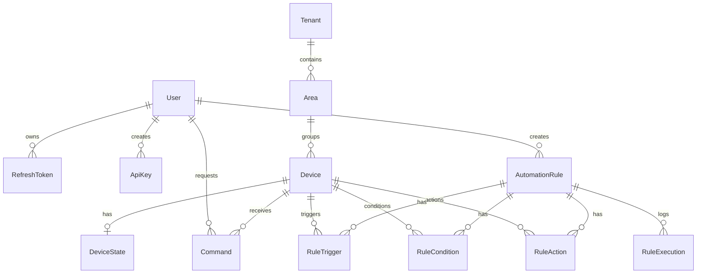

# Base de Datos

Motor: PostgreSQL 16 + TimescaleDB 2.31 (imagen propia `docker/postgres/Dockerfile`)  
ORM: Prisma

## TimescaleDB (piloto Gravix, Fase A)

- La imagen parte de la misma `postgres:16` Debian de antes, para reutilizar el volumen
  `postgres_data` sin restaurar. TimescaleDB se instala del repositorio de Timescale: el paquete del
  repositorio de PostgreSQL es solo la parte "apache" y no permite compresion ni politicas.
- `shared_preload_libraries=timescaledb` se pasa en `command` de `docker-compose.yml`.
- `readings`: hypertable (particiones de 1 dia) con una fila por equipo, variable y hora; llave
  `(deviceId, metric, time)`; columna `quality` (real / recuperada / estimada). Se comprime sola a
  los 7 dias. La llena `TimeseriesService` con cada sync de los equipos Modbus de los Agente_Go.
- `reading_gaps`: huecos (equipo sin lecturas nuevas por mas de 45 s) que abre y cierra
  `GapDetectorService`, con su causa.
- Consultas: `GET /pilot/:buildingKey/devices`, `/pilot/devices/:id/series`, `/pilot/devices/:id/gaps`
  (pestaña Piloto Gravix).

## Modelo Principal

## Tablas Relevantes

- `users`: usuarios del sistema.
- `refresh_tokens`: tokens persistentes.
- `api_keys`: integraciones externas.
- `tenants`: contexto de edificio/nivel.
- `areas`: areas fisicas con imagen y poligonos.
- `devices`: dispositivos IoT.
- `device_states`: ultimo estado conocido.
- `commands`: comandos enviados a dispositivos.
- `automation_rules`: reglas.
- `rule_triggers`: disparadores.
- `rule_conditions`: condiciones.
- `rule_actions`: acciones.
- `rule_executions`: ejecuciones historicas.
- `event_logs`: auditoria de eventos.

## Migraciones Actuales

- `20260909205906_init`: esquema inicial.
- `20260911165500_add_ewelink_protocol`: soporte eWeLink.
- `20260914154643_add_api_keys`: API keys.
- `20260917005313_add_tenant_area`: tenants, areas y relacion device-area.
- `20260917021941_add_area_points`: poligonos para areas.
- `20260917161123_add_schedule_trigger`: triggers por horario.

## Seed

`apps/api/prisma/seed.ts` crea el usuario admin si no existe. Tambien puede crear areas iniciales solo si no hay ningun tenant configurado. Esto evita duplicar areas cuando se restaura data real desde ambiente local.

