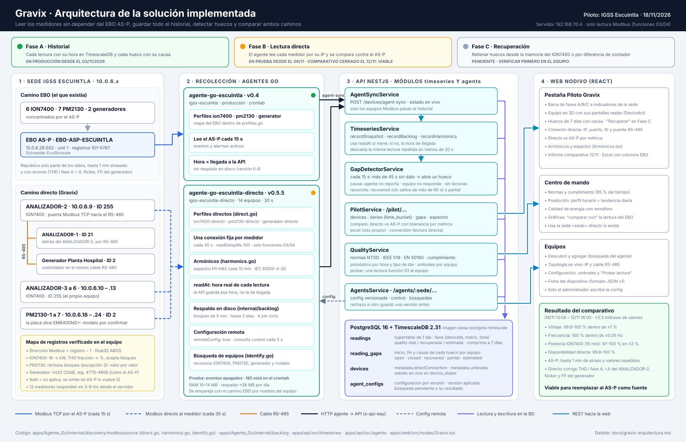
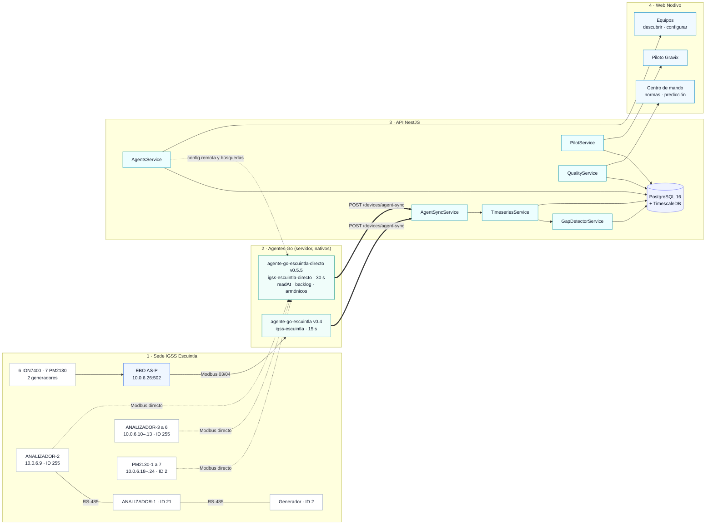
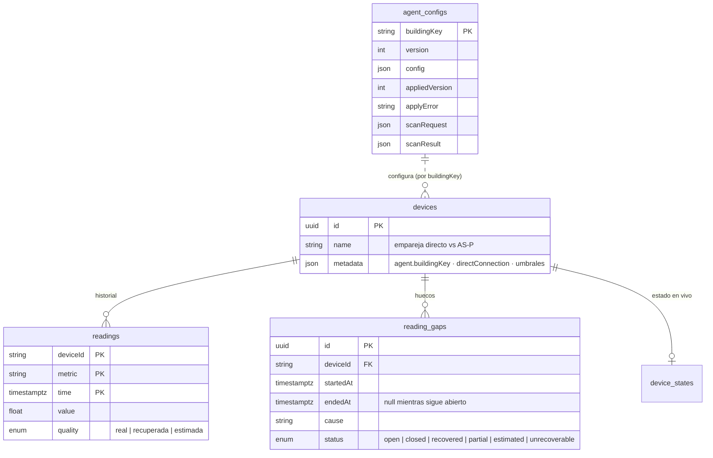
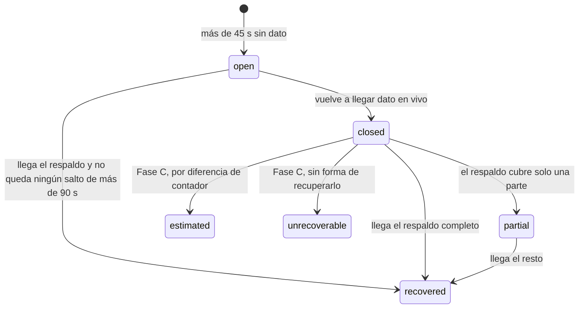
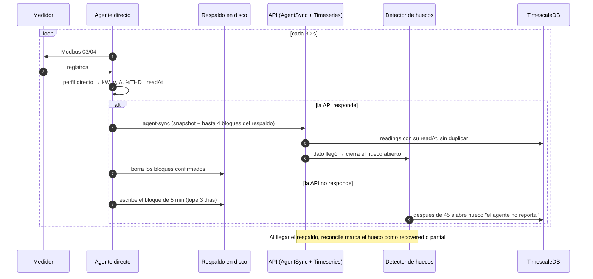
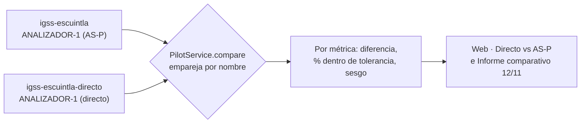
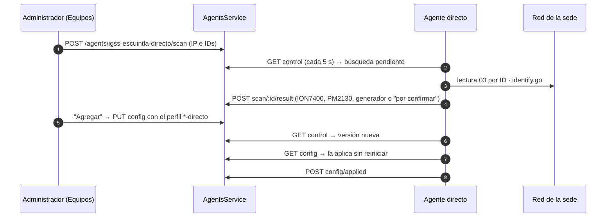

# Gravix: arquitectura de la solución implementada

Estado al **18/11/2026**. Sede piloto: **IGSS Escuintla**. Servidor: **192.168.70.4 (pruebas)**.

> En producción cada sede nueva tendrá **su propio Gravix local** (VM Linux con Docker), igual que
> hoy cada sede de Telemetría 1 tiene su AS-P. El diseño está en [gravix-sede.md](./gravix-sede.md).

Gravix es la solución de SIASA para que las sedes **no dependan del EBO AS-P ni de sus licencias**
para tener sus datos de energía. El software lee los medidores, guarda todo el historial con su hora,
detecta los datos que faltan y, en la fase final, los recupera. Este documento describe **lo que ya
está construido y funcionando**. La bitácora del despliegue, el mapa de registros y el detalle del
comparativo están en [piloto-gravix.md](./piloto-gravix.md).



Archivos del diagrama: [SVG](./diagramas/gravix-arquitectura.svg) ·
[PNG en alta resolución](./diagramas/gravix-arquitectura.png).

---

## 1. Alcance y fases

| Fase | Qué resuelve | Estado |
| --- | --- | --- |
| **A. Historial** | Cada lectura se guarda con su hora en PostgreSQL + TimescaleDB y cada hueco queda registrado con su causa | **En producción** desde el 03/11/2026 |
| **B. Lectura directa** | El agente lee cada medidor por su propia IP, sin pasar por el AS-P, y se compara contra el AS-P | **En prueba** desde el 09/11/2026 con los 14 equipos. Comparativo cerrado el 12/11: **viable** |
| **C. Recuperación** | Rellenar los huecos desde la memoria del ION7400 (dato "recuperado") o por diferencia de contador (dato "estimado") | **Pendiente**. Primero hay que verificar en el equipo cómo se lee su memoria |

El piloto se limita a Escuintla hasta que esté validado por completo. Las sedes de Telemetría 2 y 3
todavía no existen.

Principios que no cambian:

- **Solo lectura.** El agente usa solo las funciones Modbus 03 y 04. No existe código para escribir en
  un medidor.
- **En paralelo, sin tocar producción.** El camino del AS-P sigue funcionando igual mientras se
  prueba la lectura directa.
- **Nada se pierde.** Si la API o la red se caen, el agente guarda lo leído en disco y lo reenvía con
  su hora real.

## 2. Vista por capas



## 3. Capa 1: la sede y sus dos caminos

### Camino EBO (el que existía)

Los 6 ION7400, los 7 PM2130 y los 2 generadores llegan al **EBO AS-P** (10.0.6.26:502, unit 1). El AS-P
republica un subconjunto de sus valores en los registros 101–5787. Es el camino que usa el monitoreo
de siempre, y Gravix lo sigue leyendo sin cambios.

Problemas medidos en el comparativo: llega **hasta 1 minuto atrasado**, repite valores (hasta 2 minutos
sin cambiar) y entrega mal algunos datos: THD de corriente fase A en 0, corriente A del ANALIZADOR-2
en 0, flicker con escala variable y factor de potencia del generador en 16.

### Camino directo (Gravix)

| Equipo | IP | ID Modbus | Cómo se llega |
| --- | --- | --- | --- |
| ANALIZADOR-2 | 10.0.6.9 | 255 | Es el único con IP propia en ese tablero y hace de puerta hacia el RS-485 |
| ANALIZADOR-1 | 10.0.6.9 | 21 | Por RS-485, detrás del ANALIZADOR-2 |
| Generador Planta Hospital | 10.0.6.9 | 2 | Controlador en el mismo cable RS-485 |
| ANALIZADOR-3 a 6 | 10.0.6.10 – .13 | 255 | Directo (255 = "este mismo equipo"; con otros IDs reenvían al puerto serie) |
| PM2130-1 a 7 | 10.0.6.18 – .24 | 2 | Directo. La placa dice EM6400NG+: modelo por confirmar |

El ID de la consulta decide quién contesta detrás de una misma IP. El "Generador Módulos" (bloque 5743
del AS-P) todavía no se lee directo.

Reglas del mapa de registros, verificadas contra el equipo:

- Dirección Modbus = registro − 1, float32 en orden ABCD.
- **ION7400:** potencias en W y VA (se pasan a kW y kVA), THD como fracción (se pasa a %). Acepta lecturas en bloque.
- **PM2130:** potencias ya en kW, THD ya en %, energías int64 en Wh. **Rechaza cualquier bloque** que no
  empiece justo en un valor (excepción 3), así que se lee valor por valor.
- **Generador:** registros 4770–4806 del controlador, int32 CDAB (los mismos que lee el AS-P).
- **NaN = no aplica** (por ejemplo, la fase C de un PM2130 monofásico). Se omite; el AS-P lo convierte en 0.

## 4. Capa 2: recolección (Agentes Go)

Dos agentes corren **en paralelo** en el servidor, como procesos nativos fuera de Docker. Cada uno tiene
su propio `buildingKey`, así que sus datos nunca se mezclan. La API los empareja **por nombre del
equipo** para compararlos.

| | `agente-go-escuintla` | `agente-go-escuintla-directo` |
| --- | --- | --- |
| Carpeta | `~/agente-go-escuintla/` | `~/agente-go-escuintla-directo/` |
| Versión | 0.4 | 0.5.5 |
| `buildingKey` | `igss-escuintla` | `igss-escuintla-directo` |
| Lee | El AS-P (más los sensores LoRaWAN de la sede) | Cada medidor por su IP (14 equipos) |
| Intervalo | 15 s | 30 s, `readDelayMs` 100, una conexión fija por medidor |
| Perfiles | `ion7400`, `pm2130`, `generator` | `ion7400-directo`, `pm2130-directo`, `generador-directo` |
| Hora de la lectura | Hora de llegada a la API | `readAt`: hora real en que se leyó |
| Respaldo en disco | No | Sí: `data/backlog/*.jsonl`, bloques de 5 min, hasta 3 días |
| Armónicos | No | Espectro H1–H63 del ION7400 cada 10 min |
| Configuración | `config.yaml` local | Remota (`remoteConfig: true`), editable desde la web |
| Eventos | Activos (producción) | Apagados (prueba) |
| Arranque automático | crontab `@reboot` | **No está en el crontab** |

### Piezas del agente que usa Gravix

| Código | Qué hace |
| --- | --- |
| [modbussource/client.go](../apps/Agente_Go/internal/discovery/modbussource/client.go) | Cliente Modbus TCP propio, solo funciones 03 y 04 |
| [modbussource/profiles.go](../apps/Agente_Go/internal/discovery/modbussource/profiles.go) | Perfiles del camino AS-P |
| [modbussource/direct.go](../apps/Agente_Go/internal/discovery/modbussource/direct.go) | Perfiles directos por medidor, con conversión de unidades |
| [modbussource/harmonics.go](../apps/Agente_Go/internal/discovery/modbussource/harmonics.go) | Espectro de armónicos del ION7400. Detecta solo el orden máximo (63, o 31 en ANALIZADOR-5 y 6) |
| [modbussource/identify.go](../apps/Agente_Go/internal/discovery/modbussource/identify.go) | Reconoce en una búsqueda si un ID es ION7400, PM2130 o generador, y lee el modelo (registros 50-69) |
| [internal/backlog](../apps/Agente_Go/internal/backlog/backlog.go) | Respaldo en disco: escribe lo que no se pudo enviar y lo reenvía, 4 bloques por ciclo, el más viejo primero |
| [internal/reporter](../apps/Agente_Go/internal/reporter/) | Envío a la API y consulta de la configuración remota |

Cada medidor directo es un servidor Modbus propio en la configuración (`modbusServers`), con su host,
su `unitId` y un solo equipo con su perfil. Por eso cada medidor tiene su propia conexión fija.

```yaml
# Fragmento ilustrativo (la configuración real vive en la API, versión vigente en la web → Equipos)
buildingKey: igss-escuintla-directo
remoteConfig: true
modbusServers:
  - name: ANALIZADOR-1
    enabled: true
    host: 10.0.6.9
    port: 502
    unitId: 21
    pollIntervalSeconds: 30
    readDelayMs: 100
    devices:
      - name: ANALIZADOR-1
        profile: ion7400-directo
```

## 5. Capa 3: API (NestJS, módulos `timeseries` y `agents`)

| Servicio | Archivo | Responsabilidad |
| --- | --- | --- |
| `AgentSyncService` | `apps/api/src/devices/` | Recibe el snapshot del agente, actualiza el estado en vivo y pasa los equipos Modbus al historial |
| `TimeseriesService` | [timeseries.service.ts](../apps/api/src/timeseries/timeseries.service.ts) | `recordSnapshot`, `recordBacklog`, `recordHarmonics`. Usa `readAt` si viene. No guarda la misma lectura repetida en menos de 20 s |
| `GapDetectorService` | [gap-detector.service.ts](../apps/api/src/timeseries/gap-detector.service.ts) | Cada 15 s: un equipo con más de 45 s sin dato abre un hueco con su causa. `reconcile` lo marca como recuperado o parcial cuando llega el respaldo |
| `PilotService` | [pilot.service.ts](../apps/api/src/timeseries/pilot.service.ts) | Equipos de la sede, series con `time_bucket`, huecos, comparación directo vs AS-P, espectro, Excel |
| `QualityService` | [quality.service.ts](../apps/api/src/timeseries/quality.service.ts) | Normas (NTSD, IEEE 519, EN 50160) y cumplimiento, pronóstico, umbrales por equipo, "Probar lectura" |
| `AgentsService` | [agents.service.ts](../apps/api/src/agents/agents.service.ts) | Configuración remota versionada, control y búsquedas de equipos |

### Endpoints

| Método | Ruta | Uso |
| --- | --- | --- |
| POST | `/devices/agent-sync` | El agente envía snapshot, eventos y respaldo (API key de rol `agent`) |
| GET | `/pilot/:buildingKey/devices` | Equipos de energía: estado, huecos de 7 días, % de datos completos, conexión directa |
| GET | `/pilot/devices/:id/series?metric=&minutes=` | Serie agrupada (unos 240 puntos) con sus huecos |
| GET | `/pilot/devices/:id/gaps?days=` | Huecos del equipo |
| GET | `/pilot/devices/:id/compare?minutes=` | Directo vs AS-P, por métrica y con tolerancia |
| GET | `/pilot/devices/:id/espectro?at=` | Último espectro de armónicos hasta esa hora |
| GET | `/pilot/devices/:id/excel?metrics=&minutes=&step=` | Historial en Excel, con la columna del EBO si el equipo tiene pareja |
| PUT | `/pilot/devices/:id/connection` | IP, puerto, ID, puente RS-485 (`metadata.directConnection`); solo administrador |
| GET | `/pilot/normas` · `/pilot/:buildingKey/cumplimiento` | Normas y % de cumplimiento |
| GET | `/pilot/devices/:id/pronostico` | Historia horaria y pronóstico con rango |
| GET / PUT | `/pilot/devices/:id/umbrales` | Umbrales propios del equipo |
| POST | `/pilot/devices/:id/probar` | Una lectura función 03 al equipo |
| GET / PUT | `/agents/:buildingKey/config` | Configuración remota (el PUT exige `baseVersion`) |
| GET | `/agents/:buildingKey/control` | Lo consulta el agente cada 5 s: versión vigente y búsqueda pendiente |
| POST | `/agents/:buildingKey/config/applied` | El agente informa si aplicó o rechazó una versión |
| POST / GET | `/agents/:buildingKey/scan` | La web pide una búsqueda y consulta el resultado |
| POST | `/agents/:buildingKey/scan/:scanId/result` | El agente entrega el resultado |

## 6. Datos (PostgreSQL 16 + TimescaleDB 2.31)

Imagen propia `siasa-postgres-timescale:16.15-2.31.0` sobre el mismo volumen de antes (sin restaurar los
datos). Migraciones `20261102120000_add_agent_configs` y `20261103120000_add_timeseries_readings`.



| Dato | Valor observado |
| --- | --- |
| `readings` | Hypertable de 1 día. La llave `(deviceId, metric, time)` evita duplicados en un reenvío. Compresión automática a los 7 días |
| Volumen | ≈1,150 filas por minuto con 14 equipos, ≈400 MB por día antes de comprimir |
| Armónicos | 6 ION7400 × hasta 378 valores × 144 por día ≈ 290 mil filas por día |
| Retención | Todavía no se borra nada; solo se comprime (decisión pendiente) |

### Ciclo de vida de un hueco



Causas que se registran: *el agente no reporta* (agente, enlace o API caídos), *el equipo no responde*
(el agente reporta pero marca el equipo fuera de línea) y *sin lecturas nuevas del equipo*.

## 7. Flujos principales

### 7.1 Lectura directa con respaldo en disco



Prueba hecha (09/11): 4 minutos sin API, **solo para el agente de prueba**. Se guardaron 84 lecturas
(100 KB); al volver se reenviaron 3,115 valores y los 12 huecos quedaron *recovered*, aun después de
reiniciar el agente.

### 7.2 Comparación directo vs AS-P



El comparativo ignora los armónicos (`harm_*`), porque solo existen en el camino directo.

### 7.3 Agregar un medidor desde la web



## 8. Capa 4: web

| Pantalla | Qué muestra de Gravix |
| --- | --- |
| **Piloto Gravix** ([Gravix.tsx](../apps/web/src/routes/Gravix.tsx)) | Barra de fases e indicadores; equipo en 3D con sus pantallas sobre lecturas reales ([DeviceArt.tsx](../apps/web/src/components/gravix/DeviceArt.tsx)); gráfica con huecos; mapa de huecos de 7 días; conexión directa; Directo vs AS-P; Armónicos y Espectro ([Armonicos.tsx](../apps/web/src/components/gravix/Armonicos.tsx)); Informe comparativo ([InformeComparativo.tsx](../apps/web/src/components/gravix/InformeComparativo.tsx)); Excel |
| **Centro de mando** | Normas y cumplimiento, Predicción y calidad de energía con semáforo. Usa la sede `<sede>-directo` si existe |
| **Equipos** | Descubrir y agregar, topología en vivo (IP y RS-485), configuración, umbrales, "Probar lectura" y ficha del dispositivo |

## 9. Resultado de la Fase B (09/11 – 12/11/2026)

| Qué se midió | Resultado |
| --- | --- |
| Volumen | 14 equipos por camino, ≈2.3 millones de valores |
| Disponibilidad directa | 99.8 – 100 % de los minutos |
| Voltaje | 99.6 – 100 % dentro de ±1 % |
| Frecuencia | 100 % dentro de ±0.05 Hz |
| Potencia y corriente ION7400 (15 min) | 97 – 100 % dentro de ±3 %, sesgo ≤0.2 % |
| Retraso del AS-P | Hasta 1 minuto |
| Lo que el directo corrige | THD de corriente fase A, corriente A del ANALIZADOR-2, flicker, FP y batería del generador |

**Conclusión:** la lectura directa es técnicamente viable para reemplazar al AS-P como fuente de datos.

## 10. Operación

| Tarea | Cómo |
| --- | --- |
| Ver si el agente directo corre | `ps -ef \| grep agente-go-escuintla-directo` (no usar `pkill -f` con el nombre del script: también mata la sesión SSH) |
| Arrancarlo después de reiniciar el servidor | `~/agente-go-escuintla-directo/start.sh` (no está en el crontab) |
| Cambiar su configuración | Web → **Equipos** → Configuración (se guarda como versión nueva y el agente la aplica sola) |
| Ver el log | `~/agente-go-escuintla-directo/agente.log` |
| Respaldo pendiente de enviar | `~/agente-go-escuintla-directo/data/backlog/` |
| Volver atrás la base de datos | Ver "Vuelta atrás" en [piloto-gravix.md](./piloto-gravix.md#vuelta-atrás) |

## 11. Pendientes para pasar a producción

1. **Corregir el perfil directo:** quitar el estado y los conteos del ATS (registros 411-414) de ANALIZADOR-3 y 4,
   y verificar el factor de potencia de los PM2130 (sale entre 1.05 y 1.42, probablemente codificación de 4 cuadrantes).
2. **Confirmar en la pantalla del medidor:** el THD de corriente de las fases B y C, y la escala de kW, kVA, Hz, RPM,
   carga, aceite y combustible del generador (con el motor encendido).
3. **Agregar el agente directo al crontab** para que arranque solo.
4. **Fase C:** verificar cómo se lee la memoria (data recorder) del ION7400 antes de programar la recuperación.
5. **Retención:** decidir cuánto tiempo se guarda el detalle de 15–30 s.
6. **Generador Módulos:** todavía no se lee directo.
7. **Confirmar el modelo** PM2130 o EM6400NG+.

## 12. Documentos relacionados

- [gravix-sede.md](./gravix-sede.md): diseño para producción, con un Gravix local por sede.
- [piloto-gravix.md](./piloto-gravix.md): bitácora, mapa de registros y detalle del comparativo.
- [arquitectura-general.md](./arquitectura-general.md): toda la plataforma.
- [agentes-go-manual.md](./agentes-go-manual.md): operación de los agentes.
- [centro-de-mando.md](./centro-de-mando.md): normas, predicción y pestaña Equipos.
