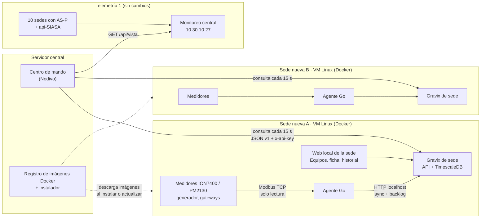
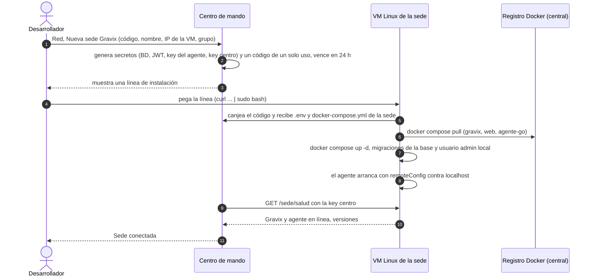

# Gravix de sede: diseño para producción

Estado: **propuesta, 18/11/2026**. Todavía no se ha programado nada de este documento.

## 1. Idea

En Telemetría 1, cada una de las 10 sedes tiene un **AS-P de Schneider en su red local**. El AS-P lee
los medidores, guarda el historial y genera las alarmas. Gravix **reemplaza al AS-P**, así que en
producción cada sede nueva tiene su **propio Gravix local**:

- **En la sede** hay una máquina virtual Linux con Docker. Ahí corre el **Agente Go** y el **Gravix de sede**,
  que guarda el historial, detecta los huecos, aplica las normas, genera las alarmas y entrega el JSON v1.
- **En el centro** está el **Centro de mando**. Es la plataforma centralizada, parecida al EBO pero mejorada.
  **Consulta a cada sede**, igual que hoy el monitoreo central consulta las api-SIASA de Telemetría 1.

El servidor **192.168.70.4 es de pruebas**. Ahí se validó que el Agente Go y Gravix funcionan con
Escuintla ([gravix-arquitectura.md](./gravix-arquitectura.md)). Este documento describe cómo se lleva eso
a un paquete que se instala en cada sede.

| | Telemetría 1 (hoy) | Sede nueva con Gravix |
| --- | --- | --- |
| Equipo en la sede | AS-P (licencia EBO) | VM Linux + Docker |
| Lectura de medidores | AS-P | Agente Go (Modbus directo, solo lectura) |
| Historial | Trends del AS-P | TimescaleDB local (`readings`) |
| Huecos y recuperación | No existe | Gravix: `reading_gaps`, respaldo en disco del agente |
| Alarmas | AS-P / EBO | Gravix: normas, umbrales y eventos de sede |
| API que consulta el centro | api-SIASA de la sede | **API del Gravix de sede**, con el mismo formato v1 |
| Plataforma central | EBO / monitoreo central | **Centro de mando** |
| Si se cae el enlace con el centro | El AS-P sigue guardando | Gravix sigue leyendo y guardando |

## 2. Vista general

Las conexiones las inicia **el centro hacia la sede**, igual que en Telemetría 1. La sede solo necesita
recibir conexiones desde la IP del servidor central.

## 3. Referencia: cómo está hoy el servidor de Escuintla (10.0.6.33)

Revisado el 18/11/2026, solo con comandos de lectura:

| Aspecto | Escuintla hoy | Qué se toma o se corrige para Gravix de sede |
| --- | --- | --- |
| Sistema | Ubuntu 24.04.4 LTS, VM KVM (interfaz `ens18`), usuario `api` en los grupos `sudo` y `docker` | **Se usa la misma base:** VM Ubuntu 24.04 con usuario `api` |
| Recursos | 4 vCPU, 2.9 GB RAM, 73 GB de disco (25 GB usados) | Mínimo sugerido: **4 GB de RAM** por TimescaleDB |
| Docker | Docker 29.1.3 (paquete de Ubuntu) + `docker-compose` 1.29.2 (versión antigua, sin `docker compose`) | El instalador instala el **plugin `docker compose` v2** |
| Proyecto | `/home/api/node-postgres-docker/`: `postgres:16` + `node-api` (api-SIASA en Node 20, `index.js`) | Ruta fija `/opt/gravix-sede/` |
| Arranque | `restart: always`, servicio docker habilitado, sin crontab | Igual: `restart: unless-stopped` |
| Logs | Rotación de 50 MB × 10, desde el incidente del 14/10 (el log llegó a 36.7 GB) | **Se copia la rotación** en todos los servicios |
| Base de datos | Puerto 5432 solo en `127.0.0.1` | Sin puerto publicado, solo red interna |
| Código | El código está montado como volumen (`./api:/app`), sin git, con varias copias `index_ANT.js` | **Imágenes con versión**, sin código montado |
| Credenciales | Contraseñas de base y JWT escritas en el compose | Secretos generados por sede en `.env` (permiso 600) |
| Acceso remoto | ZeroTier (`zerotier-one`, red 172.30.x) y SNMP | No hace falta: desde la red central se llega directo a las sedes existentes y a las nuevas |
| Puertos | 3000/3001 (API), 502 y 47808 publicados | Solo 3010 (API de sede) y 5173 (web local) |

## 4. Qué corre en cada servidor de sede

Hay un único `docker-compose.yml` en `/opt/gravix-sede/` con estos servicios:

| Servicio | Imagen | Función | Puerto |
| --- | --- | --- | --- |
| `db` | `siasa-postgres-timescale:16.15-2.31.0` (la misma de pruebas) | Historial, huecos, configuración del agente | Solo interno |
| `gravix` | Imagen de la API actual con `GRAVIX_MODO=sede` | Recibe al agente, guarda, detecta huecos, normas, alarmas, API para el centro | `3010` |
| `web` | Imagen web actual en modo sede | Equipos, ficha, búsqueda, historial y Piloto de esa sede | `5173` |
| `agente` | Imagen nueva `agente-go` | Lee los medidores con `remoteConfig: true` contra `http://localhost:3010` | Ninguno |
| `redis` | `redis:7` | Lo pide hoy la API (BullMQ). Se puede quitar después en modo sede | Solo interno |

Detalles:

- **El agente usa `network_mode: host`.** Así llega a la LAN de los medidores igual que un programa
  instalado en la VM, y la búsqueda de equipos funciona en toda la red de la sede.
- **El backlog del agente** (`data/`) y la base de datos van en **volúmenes de Docker**. Sobreviven a
  reinicios y actualizaciones.
- **Mosquitto no hace falta** en la sede mientras no haya equipos MQTT o LoRaWAN. Se agrega si una sede lo necesita.
- **Respaldo:** cada noche se guarda un `pg_dump` en `/opt/gravix-sede/respaldos/` y se conservan 7 días.

Tamaño sugerido de la VM: **2 vCPU, 4 GB de RAM y 100 GB de disco**. Hay que confirmarlo midiendo cuánto
crece por día la base de Escuintla en el servidor de pruebas, y luego decidir la retención del detalle de
15–30 s (pendiente 5 de [gravix-arquitectura.md](./gravix-arquitectura.md#11-pendientes-para-pasar-a-producción)).

## 5. La misma API en dos modos

No se escribe un Gravix nuevo. **Se reutiliza el código que ya funciona en pruebas**, y la variable
`GRAVIX_MODO` decide qué módulos carga `app.module.ts`:

| Módulo | `central` (servidor central) | `sede` (servidor de sede) |
| --- | --- | --- |
| `prisma`, `auth`, `api-keys`, `users`, `access` | ✅ | ✅ (usuarios locales de la sede) |
| `devices` (agent-sync) | ✅ | ✅ |
| `agents` (configuración remota y búsqueda) | ✅ | ✅ |
| `timeseries` (historial, huecos, normas, pronóstico) | ✅ | ✅ |
| `site-events` (alarmas) | ✅ | ✅ |
| `sede` (**nuevo**: la API que consulta el centro) | — | ✅ |
| `centro` (monitoreo central + **colector de sedes Gravix**) | ✅ | — |
| `red` (grupos, sedes, instalador) | ✅ | — |
| `adapters` (TEC 3: BACnet, eWeLink, HA), `automations`, `areas` | ✅ | — |

### API de la sede (lo que consulta el Centro de mando)

Ruta base `http://<IP de la sede>:3010/api/v1/sede`. Usa una API key de solo lectura con el rol nuevo
`centro`, que el instalador crea.

| Método y ruta | Devuelve | Hoy existe como |
| --- | --- | --- |
| `GET /telemetria` | Formato v1 de Telemetría 1: `devices[]` con ficha y `metrics` | `GET /red/sedes/:id/telemetria` |
| `GET /vista` | Resumen por equipo (estado, kW, V, A) con el mismo formato de cada sede en `/api/vista` | Nuevo (se arma con los mismos datos) |
| `GET /eventos?dispositivo=&dias=` | Alarmas con apertura y cierre | `GET /sites/:buildingKey/events` |
| `GET /historial?device=&metric=&desde=&hasta=` | Serie de una métrica | `GET /pilot/devices/:id/series` |
| `GET /huecos?device=` | Huecos con su causa y estado | `GET /pilot/devices/:id/gaps` |
| `GET /salud` | Versión de Gravix y del agente, última lectura, huecos abiertos, disco libre | Nuevo |

El historial **se queda en la sede**, como pasaba con los trends del AS-P. El Centro de mando lo pide
cuando alguien abre una gráfica, y guarda su foto de un minuto en `centro_lecturas` como ya hace hoy.

## 6. Qué cambia en el Centro de mando

1. **`red_sedes` incorpora el origen `gravix`.** Los campos nuevos son `url` (por ejemplo `http://10.20.5.10:3010`),
   la API key cifrada, la versión instalada y el último contacto. Hoy existen `central` (Telemetría 1) y
   `nodivo` (agentes en el servidor de pruebas).
2. **Colector de sedes Gravix.** Cada 15 s consulta `GET /sede/vista` de cada sede `gravix`, con el mismo
   ritmo que la vista central. Mezcla el resultado con la vista de 10.30.10.27, así el mapa, los totales
   y la actividad muestran las 10 sedes de Telemetría 1 y las sedes nuevas juntas.
3. **Sede sin respuesta:** se marca como en Telemetría 1 (`sin_respuesta`). La sede no pierde datos,
   porque su Gravix sigue guardando.
4. **Gráficas, alarmas y JSON v1** de una sede Gravix se piden a esa sede, a través del Centro de mando.
5. **Botón "Abrir Gravix de la sede"** que lleva a la web local, para agregar equipos y editar la ficha.

## 7. Instalar una sede nueva (paso a paso)

La instalación la hace **el desarrollador**. La meta es que sea **un solo comando** en la VM nueva, sin
copiar archivos a mano.

Lo que hace el comando en la VM, en orden:

1. Comprueba que la VM sea Linux de 64 bits y que tenga espacio libre.
2. **Instala Docker Engine y Docker Compose** si no están, y los deja activados para que arranquen
   al encender la VM.
3. Crea `/opt/gravix-sede/` con `docker-compose.yml`, `.env` (permiso 600) y el script `gravix-sede`.
4. Descarga las imágenes y levanta **Gravix, la base de datos, la web y el Agente Go juntos**, en el
   mismo compose. Son contenedores separados, pero se instalan, arrancan y actualizan como un solo paquete.
   Todos tienen `restart: unless-stopped`: si la VM se reinicia o un contenedor se cae, vuelven a arrancar solos.
5. Avisa al Centro de mando que la sede quedó instalada.

Si la VM no tiene salida a internet para instalar Docker, se usa el **paquete sin red**: los paquetes
de Docker y las imágenes van en un archivo que se copia una sola vez.

Después de instalar, **todo se hace desde la web y sin entrar a la VM**:

1. En la web de la sede: **Equipos → Buscar equipos**. El agente recorre la red local.
2. **Agregar equipo**, llenar la **ficha** y ajustar los umbrales. El agente lo aplica en unos segundos y sin reiniciar.
3. Gravix guarda el historial, detecta huecos y genera alarmas.
4. El Centro de mando ve la sede en la próxima consulta (15 s).

Requisitos de red de la sede:

| Desde | Hacia | Puerto | Para qué |
| --- | --- | --- | --- |
| VM de la sede | Medidores y gateways | 502/TCP | Lectura Modbus |
| VM de la sede | Servidor central | 3010 y 5000/TCP | Instalador y registro de imágenes (solo al instalar o actualizar) |
| Servidor central | VM de la sede | 3010/TCP | Consultas del Centro de mando. El firewall de la VM solo permite la IP del central |
| PC del desarrollador | VM de la sede | 5173 y 22/TCP | Web local y soporte |

Si una VM no llega al registro central, hay una **alternativa sin red**. El instalador va con las imágenes
en un archivo (`docker save`) que se copia una sola vez con la VM.

## 8. Control de claves desde el Centro de mando

Cada sede tiene sus propias claves y **el inventario completo se lleva en el Centro de mando**:

| Clave | Para qué | Dónde se usa |
| --- | --- | --- |
| Clave del agente (rol `agent`) | El Agente Go envía lecturas a su Gravix | Dentro de la VM |
| Clave del centro (rol `centro`, solo lectura) | El Centro de mando consulta la sede | Centro de mando → sede |
| Código de instalación | Instalar una sola vez; vence en 24 h | Al instalar |

En **Centro de mando → Red → Sedes Gravix** aparece, por sede: cada clave, quién la creó y cuándo,
el último uso, su estado (activa o revocada) y la versión instalada. Las acciones disponibles son:

- **Rotar:** crea una clave nueva, la entrega a la sede por la conexión del centro y desactiva la anterior.
  El agente toma la clave nueva sin que nadie entre a la VM.
- **Revocar:** desactiva una clave de inmediato, por ejemplo si se retira una sede o se sospecha de una fuga.

El Centro de mando **no muestra las claves completas**, solo los últimos 4 caracteres, igual que hoy
las API keys de Nodivo. El auditor de acceso registra cada creación, rotación y revocación.

## 9. Versiones y actualizaciones

**Por qué llevan versión.** Con varias sedes, cuando se corrige un error o se agrega un tipo de medidor,
hay que saber **qué sedes ya tienen la corrección y cuáles no**. La versión también sirve para:

- **Compatibilidad:** el Centro de mando sabe qué formato de JSON entrega cada sede.
- **Vuelta atrás:** si una versión nueva falla, se regresa a la anterior exacta.
- **Soporte:** ante un inconveniente en una sede, lo primero que se revisa es qué versión corre.

Para no complicarlo, **Gravix, la web y el Agente Go van con un único número de versión de paquete**
(por ejemplo `gravix-sede 1.0.0`). Cada sede lo reporta en `/sede/salud`, y el Centro de mando lo
muestra junto al estado de la sede.

- **Primera etapa:** el Centro de mando muestra qué versión tiene cada sede. El desarrollador ejecuta
  en la VM `gravix-sede actualizar 0.6.1`. El script baja las imágenes, respalda la base, aplica las
  migraciones y, si algo falla, vuelve a la versión anterior.
- **Segunda etapa:** un botón en el Centro de mando para "Actualizar sede". La sede revisa cada
  hora qué versión le corresponde y se actualiza sola en un horario de bajo uso.

## 10. Plan de construcción

| Fase | Entregable | Cómo se prueba |
| --- | --- | --- |
| **1. Modo sede** | `GRAVIX_MODO`, módulo `sede` con sus 6 rutas, rol `centro`, imagen Docker del agente, `docker-compose` de sede | En una VM Linux de prueba (no en 192.168.70.4), leyendo un simulador Modbus o un medidor de laboratorio |
| **2. Colector** | Origen `gravix` en `red_sedes`, colector cada 15 s y mezcla con la vista central | El Centro de mando en pruebas muestra la VM de la fase 1 como una sede más |
| **3. Instalador** | Código de un solo uso, línea de instalación, registro Docker en el central, script `gravix-sede` | Instalar desde cero en una VM limpia con un solo comando |
| **4. Operación** | Respaldo nocturno, `actualizar` con vuelta atrás, pantalla de versiones | Actualizar la VM de prueba de 0.6.0 a 0.6.1 y forzar una falla para ver la vuelta atrás |

Cuidado con Escuintla: **no se debe leer los mismos medidores con dos agentes a la vez**. ANALIZADOR-2
es el gateway RS-485 de varios equipos. Si Escuintla pasa a tener su VM, el agente
`igss-escuintla-directo` se **mueve** a esa VM; no se duplica.

## 11. Decisiones pendientes

1. **Dónde vive el Centro de mando en producción** y su IP. Es el destino del instalador y del registro.
2. **Distribución Linux de las VM** (por ejemplo Ubuntu 24.04) y si tienen salida a internet para instalar Docker.
3. **Rango de IP** de las VM de sede y si hay ruta desde el central a cada una.
4. **Retención del detalle** de 15–30 s en cada sede: define el disco de la VM.
5. **Usuarios de la web local:** solo el desarrollador, o también el personal de mantenimiento de la sede.

## 12. Documentos relacionados

- [gravix-arquitectura.md](./gravix-arquitectura.md): lo construido y probado en 192.168.70.4.
- [arquitectura-general.md](./arquitectura-general.md): toda la plataforma.
- [centro-de-mando.md](./centro-de-mando.md): Centro de mando, permisos y red por fases.
- [agentes-go-manual.md](./agentes-go-manual.md): operación de los agentes.
