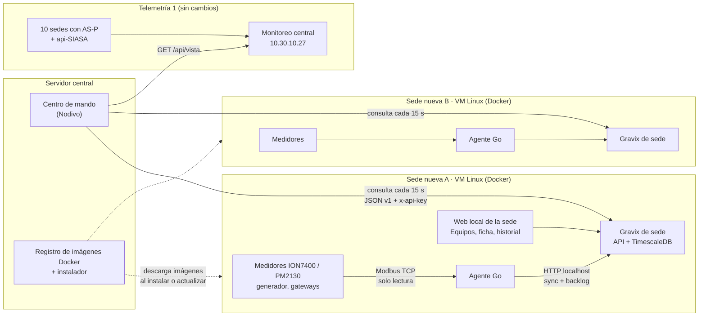
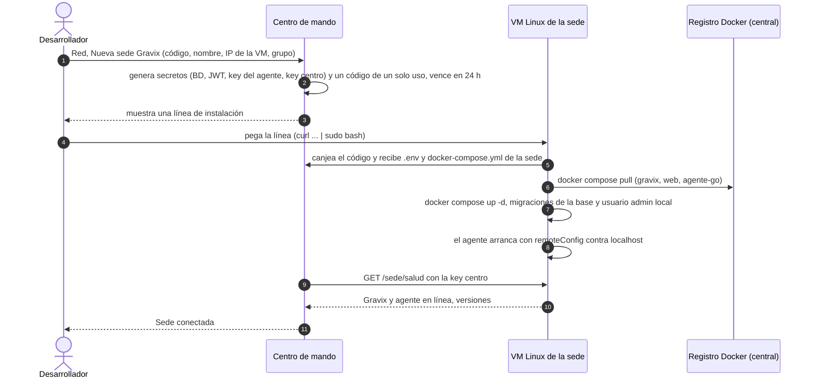

# Gravix de sede: diseño para producción

Estado al **19/11/2026**: **fases 1 y 2 construidas y funcionando** en 192.168.70.4.
- El Docker de prueba `gravix-sede-prueba` hace de sede (ver [§13](#13-docker-de-prueba-en-1921687004)).
- El Centro de mando ya lo consulta como la sede "Escuintla · Gravix de sede (prueba)".
- Las fases 3 (instalador) y 4 (operación) siguen pendientes.

## 1. Idea

En Telemetría 1, cada una de las 10 sedes tiene un **AS-P de Schneider en su red local**. El AS-P lee
los medidores, guarda el historial y genera las alarmas. Gravix **reemplaza al AS-P**, así que en
producción cada sede nueva tiene su **propio Gravix local**:

- **En la sede** hay una máquina virtual Linux con Docker. Ahí corre el **Agente Go** y el **Gravix de sede**,
  que guarda el historial, detecta los huecos, aplica las normas, genera las alarmas y entrega el JSON v1.
- **En el centro** está el **Centro de mando**. Es la plataforma centralizada, parecida al EBO pero mejorada.
  **Consulta a cada sede**, igual que hoy el monitoreo central consulta las api-SIASA de Telemetría 1.

El servidor **192.168.70.4 es de pruebas**. Ahí se validó que el Agente Go y Gravix funcionan con
Escuintla ([gravix-arquitectura.md](./gravix-arquitectura.md)). Este documento describe cómo se lleva eso
a un paquete que se instala en cada sede.

| | Telemetría 1 (hoy) | Sede nueva con Gravix |
| --- | --- | --- |
| Equipo en la sede | AS-P (licencia EBO) | VM Linux + Docker |
| Lectura de medidores | AS-P | Agente Go (Modbus directo, solo lectura) |
| Historial | Trends del AS-P | TimescaleDB local (`readings`) |
| Huecos y recuperación | No existe | Gravix: `reading_gaps`, respaldo en disco del agente |
| Alarmas | AS-P / EBO | Gravix: normas, umbrales y eventos de sede |
| API que consulta el centro | api-SIASA de la sede | **API del Gravix de sede**, con el mismo formato v1 |
| Plataforma central | EBO / monitoreo central | **Centro de mando** |
| Si se cae el enlace con el centro | El AS-P sigue guardando | Gravix sigue leyendo y guardando |

## 2. Vista general



Las conexiones las inicia **el centro hacia la sede**, igual que en Telemetría 1. La sede solo necesita
recibir conexiones desde la IP del servidor central.

## 3. Referencia: cómo está hoy el servidor de Escuintla (10.0.6.33)

Revisado el 18/11/2026, solo con comandos de lectura:

| Aspecto | Escuintla hoy | Qué se toma o se corrige para Gravix de sede |
| --- | --- | --- |
| Sistema | Ubuntu 24.04.4 LTS, VM KVM (interfaz `ens18`), usuario `api` en los grupos `sudo` y `docker` | **Se usa la misma base:** VM Ubuntu 24.04 con usuario `api` |
| Recursos | 4 vCPU, 2.9 GB RAM, 73 GB de disco (25 GB usados) | Mínimo sugerido: **4 GB de RAM** por TimescaleDB |
| Docker | Docker 29.1.3 (paquete de Ubuntu) + `docker-compose` 1.29.2 (versión antigua, sin `docker compose`) | El instalador instala el **plugin `docker compose` v2** |
| Proyecto | `/home/api/node-postgres-docker/`: `postgres:16` + `node-api` (api-SIASA en Node 20, `index.js`) | Ruta fija `/opt/gravix-sede/` |
| Arranque | `restart: always`, servicio docker habilitado, sin crontab | Igual: `restart: unless-stopped` |
| Logs | Rotación de 50 MB × 10, desde el incidente del 14/10 (el log llegó a 36.7 GB) | **Se copia la rotación** en todos los servicios |
| Base de datos | Puerto 5432 solo en `127.0.0.1` | Sin puerto publicado, solo red interna |
| Código | El código está montado como volumen (`./api:/app`), sin git, con varias copias `index_ANT.js` | **Imágenes con versión**, sin código montado |
| Credenciales | Contraseñas de base y JWT escritas en el compose | Secretos generados por sede en `.env` (permiso 600) |
| Acceso remoto | ZeroTier (`zerotier-one`, red 172.30.x) y SNMP | No hace falta: desde la red central se llega directo a las sedes existentes y a las nuevas |
| Puertos | 3000/3001 (API), 502 y 47808 publicados | Solo 3010 (API de sede) y 5173 (web local) |

## 4. Qué corre en cada servidor de sede

Hay un único `docker-compose.yml` en `/opt/gravix-sede/` con estos servicios:

| Servicio | Imagen | Función | Puerto |
| --- | --- | --- | --- |
| `db` | `siasa-postgres-timescale:16.15-2.31.0` (la misma de pruebas) | Historial, huecos, configuración del agente | Solo interno |
| `gravix` | Imagen de la API actual con `GRAVIX_MODO=sede` | Recibe al agente, guarda, detecta huecos, normas, alarmas, API para el centro | `3010` |
| `web` | Imagen web actual en modo sede | Equipos, ficha, búsqueda, historial y Piloto de esa sede | `5173` |
| `agente` | `gravix-sede-agente` (Alpine, 16 MB) | Lee los medidores con `remoteConfig: true` contra `http://gravix:3000` | Ninguno |
| `redis` | `redis:7` | Lo pide hoy la API (BullMQ). Se puede quitar después en modo sede | Solo interno |
| `mosquitto` | `eclipse-mosquitto:2` | Lo pide hoy el adaptador MQTT de la API. Se puede quitar después | Solo interno |

Detalles:

- **El agente va en la red interna de Docker.** La lectura Modbus TCP y la búsqueda de equipos salen
  a la LAN de la sede por la VM. Solo si una sede necesita BACnet por broadcast o recibir gateways
  LoRa (UDP 1700), ese contenedor se cambia a `network_mode: host`.
- **El `config.yaml` del agente se arma solo** al arrancar el contenedor, a partir del `.env`
  (`docker-entrypoint.sh`). Lleva lo básico; los equipos vienen de la configuración remota.
- **nginx de la web local** resuelve `gravix` con el DNS interno de Docker en cada consulta
  (`resolver 127.0.0.11`). Sin eso, después de actualizar o recrear el contenedor de Gravix, la web
  daba 502 hasta reiniciarla (encontrado y corregido el 19/11).
- **El backlog del agente** (`/data`) y la base de datos van en **volúmenes de Docker**. Sobreviven a
  reinicios y actualizaciones.
- **La web local** usa rutas relativas (`/api/v1`, `/ws`) y nginx las pasa a la API, así **la misma
  imagen sirve para cualquier sede**. En modo sede solo muestra Equipos, Piloto Gravix y Usuarios.
- **Rotación de logs** de 50 MB × 10 en todos los servicios, la misma que se aplicó en Escuintla tras el incidente del 14/10.
- **Cada sede tiene su propio InfluxDB 2.8** (servicio `influxdb` del compose; decisión del 19/11).
  `generar-env.sh` crea su clave de admin y su token. Cada lectura que se guarda en TimescaleDB se
  envía **al mismo tiempo** a ese InfluxDB (`timeseries/influx-writer.service.ts`).
  - **TimescaleDB sigue siendo la base principal.** Los huecos, las normas, la comparación y la
    recuperación salen de ahí. InfluxDB es una copia para tableros como Grafana.
  - **Formato:** measurement `lectura`, tags `sede`, `agente`, `equipo` y `device_id`, un field por métrica y hora de lectura en ms.
  - **Si InfluxDB se cae**, Gravix guarda en memoria hasta 200 000 líneas y reintenta cada 5 s. Nunca
    frena el guardado en TimescaleDB.
  - **Estado:** `/sede/salud` → `bases.influx` muestra las líneas escritas, el último envío correcto, el error y las pendientes.
- **Respaldo:** cada noche se guarda un `pg_dump` en `/opt/gravix-sede/respaldos/` y se conservan 7 días.

Tamaño sugerido de la VM: **2 vCPU, 4 GB de RAM y 100 GB de disco**. Hay que confirmarlo midiendo cuánto
crece por día la base de Escuintla en el servidor de pruebas, y luego decidir la retención del detalle de
15–30 s (pendiente 5 de [gravix-arquitectura.md](./gravix-arquitectura.md#11-pendientes-para-pasar-a-producción)).

## 5. La misma API en dos modos

No se escribe un Gravix nuevo. **Se reutiliza el código que ya funciona en pruebas**, y la variable
`GRAVIX_MODO` decide qué módulos carga `app.module.ts`:

| Módulo | `central` (servidor central) | `sede` (servidor de sede) |
| --- | --- | --- |
| `prisma`, `auth`, `api-keys`, `users`, `access` | ✅ | ✅ (usuarios locales de la sede) |
| `devices` (agent-sync) | ✅ | ✅ |
| `agents` (configuración remota y búsqueda) | ✅ | ✅ |
| `timeseries` (historial, huecos, normas, pronóstico) | ✅ | ✅ |
| `site-events` (alarmas) | ✅ | ✅ |
| `sede` (**nuevo**: la API que consulta el centro) | — | ✅ |
| `centro` (monitoreo central + **colector de sedes Gravix**) | ✅ | — |
| `red` (grupos, sedes, instalador) | ✅ | — |
| `ewelink`, `bacnet` (TEC 3), `automations`, `areas` | ✅ | — |
| `adapters` (los usa `devices`; sin LoRaWAN si no hay `LORAWAN_MQTT_URL`) | ✅ | ✅ |

### API de la sede (lo que consulta el Centro de mando)

Ruta base `http://<IP de la sede>:3010/api/v1`. Usa la **clave del centro** (`x-api-key`) con rol
`viewer`: solo lectura y sin acceso a escribir nada. La API la registra sola al arrancar desde
`CENTRO_API_KEY` del `.env`, igual que la clave del agente (`AGENT_API_KEY`, rol `agent`).

| Método y ruta | Devuelve | Estado |
| --- | --- | --- |
| `GET /sede/salud` | Sede, versión del paquete, agentes (versión de config aplicada, último sync), equipos, última lectura, huecos abiertos, disco | **Construido** |
| `GET /sede/vista` | Resumen por equipo (estado, kW, V prom., A prom.) con la forma de cada sede en `/api/vista` | **Construido** |
| `GET /sede/telemetria` | Formato v1 de Telemetría 1: `devices[]` con ficha y `metrics` | **Construido** (mismo código que `/red/sedes/:id/telemetria`, ahora en `red/telemetria.ts`) |
| `GET /pilot/:buildingKey/devices` | Equipos con su pareja directo/EBO | Ya existía, se usa tal cual |
| `GET /pilot/devices/:id/series` · `/gaps` · `/compare` · `/espectro` · `/excel` | Historial, huecos, comparación, armónicos, Excel | Ya existía, se usa tal cual |
| `GET /sites/:buildingKey/events` | Alarmas de la sede | Ya existía, se usa tal cual |

El historial **se queda en la sede**, como pasaba con los trends del AS-P. El Centro de mando lo pide
cuando alguien abre una gráfica, y guarda su foto de un minuto en `centro_lecturas` como ya hace hoy.

## 6. Qué cambia en el Centro de mando (fase 2, construida el 19/11)

1. **`red_sedes` incorpora el origen `gravix`.** Se agregaron dos columnas en la migración
   `20261119180000_red_sedes_gravix`:
   - `url`: la API de la sede, por ejemplo `http://10.20.5.10:3010`.
   - `apiKeyEnc`: la clave de consulta **cifrada con AES-256-GCM**. La llave sale de
     `GRAVIX_KEYS_SECRET` o, si no existe, de `JWT_ACCESS_SECRET`.

   `GET /red` nunca devuelve la clave: solo `claveFinal` (los últimos 4 caracteres) y `estado`.
2. **Registro con prueba.** `POST /red/gravix/probar` (admin) llama a `/sede/salud` y da errores
   claros en estos casos:
   - no conecta;
   - clave rechazada (401);
   - clave del agente en vez de la de consulta (403);
   - la dirección es de otra cosa, por ejemplo el puerto de la web.

   Al guardar (`PUT /red/sedes/:id` con `origen: "gravix"`) se vuelve a probar, y **los agentes de
   la sede los informa la propia sede**.
3. **Colector** (`red/gravix.service.ts`).
   - Cada 15 s consulta `GET /sede/vista` de cada sede Gravix, y `GET /sede/salud` cada minuto.
   - Con eso guarda el estado de la sede: `ok`, error, último contacto, versión, latencia, equipos,
     InfluxDB y puerto de la web.
   - También aprende qué equipos tiene cada sede.
   - Cada minuto guarda kW, V y A en `centro_lecturas`, igual que con Telemetría 1.
4. **Paso automático de consultas** (`red/gravix-proxy.interceptor.ts`).
   - Las consultas GET a `/pilot/devices/:id/...`, `/pilot/:agente/devices|cumplimiento` y
     `/sites/:agente/events` de un equipo o agente de una sede Gravix **se piden a esa sede** con su
     clave: historial, huecos, comparación, armónicos, Excel, pronóstico, umbrales y alarmas.
   - Así la ventana del equipo y las demás pantallas funcionan sin cambios.
   - Los cambios (PUT/POST) a un equipo de una sede Gravix responden 409 con la dirección de su web local.
5. **JSON v1:** `GET /red/sedes/:id/telemetria` de una sede Gravix lo arma la propia sede.
6. **En la web.**
   - El asistente "Nueva sede" tiene la opción **"La sede tiene su Gravix"**: se escriben la dirección y
     la clave, se prueba la conexión y se guarda.
   - La sede aparece en el árbol y en el mapa como las sedes leídas por Agentes Go, con "Gravix de sede
     vX · dirección".
   - **"Sin respuesta"** se marca cuando el central no la alcanza. La sede no pierde datos, porque su
     Gravix sigue guardando.
   - El botón **"Abrir Gravix de la sede ↗"** lleva a su web local, donde se buscan y agregan equipos y se
     edita la ficha.
   - En "Editar sede" se puede cambiar la dirección o pegar una clave nueva.

## 7. Instalar una sede nueva (paso a paso)

La instalación la hace **el desarrollador**. La meta es que sea **un solo comando** en la VM nueva, sin
copiar archivos a mano.



Lo que hace el comando en la VM, en orden:

1. Comprueba que la VM sea Linux de 64 bits y que tenga espacio libre.
2. **Instala Docker Engine y Docker Compose** si no están, y los deja activados para que arranquen
   al encender la VM.
3. Crea `/opt/gravix-sede/` con `docker-compose.yml`, `.env` (permiso 600) y el script `gravix-sede`.
4. Descarga las imágenes y levanta **Gravix, la base de datos, la web y el Agente Go juntos**, en el
   mismo compose. Son contenedores separados, pero se instalan, arrancan y actualizan como un solo paquete.
   Todos tienen `restart: unless-stopped`: si la VM se reinicia o un contenedor se cae, vuelven a arrancar solos.
5. Avisa al Centro de mando que la sede quedó instalada.

Si la VM no tiene salida a internet para instalar Docker, se usa el **paquete sin red**: los paquetes
de Docker y las imágenes van en un archivo que se copia una sola vez.

Después de instalar, **todo se hace desde la web y sin entrar a la VM**:

1. En la web de la sede: **Equipos → Buscar equipos**. El agente recorre la red local.
2. **Agregar equipo**, llenar la **ficha** y ajustar los umbrales. El agente lo aplica en unos segundos y sin reiniciar.
3. Gravix guarda el historial, detecta huecos y genera alarmas.
4. El Centro de mando ve la sede en la próxima consulta (15 s).

Requisitos de red de la sede:

| Desde | Hacia | Puerto | Para qué |
| --- | --- | --- | --- |
| VM de la sede | Medidores y gateways | 502/TCP | Lectura Modbus |
| VM de la sede | Servidor central | 3010 y 5000/TCP | Instalador y registro de imágenes (solo al instalar o actualizar) |
| Servidor central | VM de la sede | 3010/TCP | Consultas del Centro de mando. El firewall de la VM solo permite la IP del central |
| PC del desarrollador | VM de la sede | 5173 y 22/TCP | Web local y soporte |

Si una VM no llega al registro central, hay una **alternativa sin red**. El instalador va con las imágenes
en un archivo (`docker save`) que se copia una sola vez con la VM.

## 7b. Alarmas y correos (construido el 19/11, en paralelo con api-SIASA)

Hoy los correos de alarma los envía la **api-SIASA de cada sede**, con los datos del AS-P
(`monitoreo/eventos_modbus.js`). Gravix tiene **el mismo motor**, para poder reemplazarla
(`apps/api/src/alarmas/`). Solo corre en el Gravix de sede.

**Qué es igual a api-SIASA:**
- Los eventos, con el mismo nombre, severidad y tiempos de confirmación:
  `MEDIDOR_FUERA_DE_LINEA` (3 min), `MEDIDOR_EN_CERO` (3 min), `MEDIDOR_SIN_CAMBIO` (15 min),
  "fuera de línea por valores repetidos" (5 min), `MEDIDOR_SIN_TRANSFERENCIA`,
  `MEDIDOR_VIGILANTES_DESCONECTADOS` y `MEDIDOR_ION_DESCONECTADO` (60 s), `GENERADOR_EN_MARCHA` y `DATOS_CONGELADOS` (5 min).
- Solo se vigilan los ION7400 y PM2130, igual que api-SIASA (`ion_7400_*`, `pm_2130_*`).
- **Correo:**
  - el mismo asunto (`[CRÍTICO] SIASA <sede> - <inventario> <equipo> - <título>`);
  - el mismo HTML (copia de `plantilla_correo.js`);
  - un solo correo cuando 3 o más medidores fallan a la vez;
  - advertencias agrupadas cada 15 min, recordatorios, resumen diario y máximo de correos por hora.
- **Variables:** las mismas en el `.env` de la sede (`ALERTA_*`, `ALERTAS_*`, `SMTP_*`, `MEDIDORES_GENERADOR`,
  `EVENTOS_RETENCION_MESES`), con los mismos valores que Escuintla.
- **Tabla `alarma_eventos`:** mismas columnas que `api_eventos`. `GET /sede/eventos` responde igual que
  `/api/ebo/modbus-auto/eventos` y `GET /sede/alarmas/estado` igual que `/estado`.
- **Al reiniciar** recupera los eventos abiertos y no repite correos de apertura.

**Qué cambia, por cómo lee Gravix:**
- Los datos vienen del Agente Go, que lee cada medidor directo. `DATOS_CONGELADOS` significa "Gravix no
  recibe sincronizaciones del agente".
- Las señales S1/S2 son `s1_commercial_energy_status` y `s2_generator_energy_status`.
- No existen `LECTURA_ATASCADA`, `RECONEXIONES_FRECUENTES` ni `VIGILANTE_REINICIO`: eran de la
  conexión Modbus de api-SIASA con el AS-P.
- Los códigos de evento llevan `G` en el prefijo (`ESCG-…`), para distinguirlos de los de api-SIASA (`ESC-…`).
- Si la sede todavía no tiene medidores, el estado es `sin_medidores`, no `congelado`.

**Modo paralelo (cómo queda hoy):**
- `ALERTAS_CORREO_ACTIVO=false` en el `.env` de la sede. Gravix **detecta y guarda** las alarmas y
  **arma cada correo**, pero **no lo envía**: queda en `alarma_correos` como "preparado", para compararlo
  con el que envió api-SIASA. Así no se duplican los correos.
- Para revisarlos: `GET /sede/alarmas/correos`, `GET /sede/alarmas/correos/:id` (HTML) y
  `GET /sede/alarmas/vista-previa?dispositivo=` (correo de prueba con datos reales, no se envía).
- `ALARMAS_AGENTES` dice qué agente vigila el motor. En Escuintla será el directo, porque el de EBO
  tiene los mismos medidores.

**Módulo "Alarmas y correos" en el Centro de mando** (20/11). Es una pestaña nueva, solo para
administradores, junto a Mapa, Normas y Predicción. Todo se maneja desde la web, sin entrar al servidor
ni al código. Por cada sede:

1. **¿De dónde lee el Centro de mando las alarmas?** Puede ser **api-SIASA (actual)** o **Gravix**. Elegir
   Gravix hace que el Centro de mando deje de consumir las alarmas de la api-SIASA de esa sede. Las sedes
   sin Gravix aparecen como "solo api-SIASA".
2. **Envío de correos desde Gravix.** Interruptor de encendido/apagado, más los destinatarios
   (Para, CC) y el remitente. Si se enciende mientras la api-SIASA sigue enviando, la pantalla advierte
   que se duplicarán los correos.
3. **Servidor de correo (SMTP):** servidor, puerto, SSL, usuario y clave. La clave nunca vuelve a la
   web: se escribe solo para cambiarla.
4. **Reglas:** minutos para fuera de línea, valores repetidos, voltaje en cero, sin cambio y datos
   congelados; confirmación de transferencia; recordatorios; máximo de correos por hora; medidores de
   generador; resumen diario; y encender o apagar el motor.
5. **Estado del motor y alarmas abiertas**, más los **correos de los últimos 7 días** (enviados o
   preparados), que se abren con "Ver". Botones **Vista previa del correo** y **Enviar correo de
   prueba** (este solo funciona con el envío encendido).

Cómo funciona por dentro:
- El central llama a `GET/PUT /red/sedes/:id/alarmas`, `POST /red/sedes/:id/alarmas/prueba` y
  `GET /red/sedes/:id/alarmas/correos/:id` (solo admin).
- El central se lo pasa a la sede (`GET/PUT /sede/alarmas/config`, `POST /sede/alarmas/prueba`).
- La sede **solo acepta cambios** de un administrador local o de la clave del Centro de mando
  (`SEDE_CENTRO_KEY`). Para todo lo demás, esa clave sigue siendo de solo lectura. La clave del agente recibe 403.
- Los valores se validan: correos con formato correcto, números, hora HH:MM y solo las variables permitidas.
- Lo guardado va a la tabla `alarma_config` de la sede, **tiene prioridad sobre el `.env`** y se aplica
  **al momento, sin reiniciar**. Se registra quién hizo el cambio y cuándo.

Probado el 20/11:
- leer la configuración;
- guardar un cambio;
- rechazar un correo inválido y una variable no permitida;
- correo de prueba bloqueado con el envío apagado;
- vista previa;
- 403 para el agente y 401 sin sesión.

Sigue registrada la opción anterior: `red_sedes.alarmasFuente`. Puede valer:
- **api-SIASA (actual)**, que es la opción por defecto: alarmas, campana y "hora de los correos" salen de la api-SIASA de la sede.
- **Gravix:** salen del motor de Gravix y el Centro de mando deja de leer las alarmas de api-SIASA.

Esa opción solo cambia **lo que muestra** el Centro de mando. **Quién envía** se decide en cada sistema.

**Para pasar a Gravix como emisor, en el futuro:**
1. Comparar unas semanas los correos preparados de Gravix contra los enviados por api-SIASA.
2. En el `.env` de la sede: `ALERTAS_CORREO_ACTIVO=true`, `SMTP_*` y `ALERTAS_CORREO_PARA`.
3. Quien administra la api-SIASA de la sede apaga su envío (`ALERTAS_CORREO_ACTIVO=false` en su `.env`).
4. En el Centro de mando: *Editar sede → Alarmas y correos → Gravix*.

Probado el 19/11 con un simulador de 23 casos:
- fuera de línea a los 3 min y no antes;
- correo agrupado con 3 medidores;
- voltaje en cero;
- valores repetidos;
- vigilantes a los 60 s;
- datos congelados sin disparar los medidores;
- formato de los eventos;
- ningún correo enviado.

## 7c. Consumo de la sede: TimescaleDB e InfluxDB (20/11)

**Cómo verlo siempre:**
- Abrir la **web del InfluxDB de la sede** → *Dashboards* → **"Consumo Gravix de sede"**. En prueba es
  `http://192.168.70.4:8186`, usuario `admin`, con la clave `INFLUX_ADMIN_PASSWORD` del `.env`.
- Arriba a la derecha se elige el periodo (1 h, 24 h, 7 días…) y la actualización automática.

**Cómo funciona:**
- El servicio `telegraf` del compose (`telegraf.conf`) guarda cada 10 s la memoria, CPU, red y disco
  de cada contenedor. Cada 5 min guarda también el tamaño de TimescaleDB (total, lecturas de energía,
  historial de sensores, chunks comprimidos, conexiones, caché) y el de InfluxDB.
- Todo va al bucket **`monitoreo`**, que se conserva 30 días.
- Telegraf solo lee: el socket de Docker va en solo lectura y a Postgres entra con su usuario. Consume unos 30 MB de RAM.

**Gráficas del tablero** (`tablero-consumo.yml`, se instala con `influx apply`):
- RAM y disco actuales de cada base;
- memoria real y CPU de TimescaleDB contra InfluxDB;
- tamaño de TimescaleDB (total, energía, sensores);
- tamaño de InfluxDB;
- memoria de todos los contenedores.

**Medición del 20/11** (Escuintla, 28 medidores + 122 sensores, muestreo de 60 s):

| | TimescaleDB | InfluxDB |
| --- | --- | --- |
| RAM real (la de `docker stats`) | **~390 MB** (máx. 398) | **~90–105 MB** |
| De esa RAM, memoria del proceso | 51 MB (más la caché activa de Postgres) | 84 MB |
| Caché de archivos del sistema (se libera si otro programa la necesita) | 5.5 GB | 29 MB |
| CPU (de un núcleo) | promedio 1.8 %, máximo 5.3 % | promedio 0.07 %, máximo 0.4 % |
| Disco | **13.0 GB**: 7.2 GB de energía (10 de 18 chunks ya comprimidos) y 5.8 GB del historial de sensores | **34 MB** (unas 21 h de copia, solo energía) |
| Escritura | ~2 360 lecturas de energía por minuto | ~73 000 puntos por día |
| Configuración de memoria | `shared_buffers` 128 MB (el valor de fábrica), `work_mem` 4 MB, 11 conexiones, caché 97.4 % | Sin límite |

**Tarea programada "Resumen de consumo por hora"** (`tarea-consumo.flux`, creada el 20/11):
- Corre en InfluxDB cada hora, 2 min después de la hora en punto.
- Toma el detalle de `monitoreo` y guarda en el bucket **`monitoreo_horas`** (se conserva **365 días**),
  measurement `consumo_hora`, tag `servicio`.
- Por cada contenedor guarda `ram_mb_prom`, `ram_mb_max`, `cpu_pct_prom` y `cpu_pct_max`. Además,
  `disco_gb` para `timescaledb` y `disco_mb` para `influxdb`.
- Así se ve la tendencia de meses aunque el detalle de 10 s solo dure 30 días.
- Se revisa en la web de InfluxDB → *Tasks* (ícono de calendario) → "Resumen de consumo por hora":
  cada ejecución y su registro.
- Se instala con `influx task create -o <org> -t <token> -f tarea-consumo.flux`, después de crear el bucket
  `monitoreo_horas` con retención de 365 días.

**Notas:**
- Ningún contenedor tiene límite de memoria. En una VM de 4 GB conviene poner límites, por ejemplo
  TimescaleDB 1.5 GB e InfluxDB 512 MB, y subir `shared_buffers` a unos 512 MB.
- La caché de 5.5 GB no es consumo real: es memoria libre que Linux usa como caché de disco.

## 8. Control de claves desde el Centro de mando

Cada sede tiene sus propias claves y **el inventario completo se lleva en el Centro de mando**:

| Clave | Para qué | Dónde se usa |
| --- | --- | --- |
| Clave del agente (rol `agent`) | El Agente Go envía lecturas a su Gravix | Dentro de la VM |
| Clave del centro (rol `viewer`, solo lectura) | El Centro de mando consulta la sede | Centro de mando → sede |
| Código de instalación | Instalar una sola vez; vence en 24 h | Al instalar |

En **Centro de mando → Red → Sedes Gravix** aparece, por sede: cada clave, quién la creó y cuándo,
el último uso, su estado (activa o revocada) y la versión instalada. Las acciones disponibles son:

- **Rotar:** crea una clave nueva, la entrega a la sede por la conexión del centro y desactiva la anterior.
  El agente toma la clave nueva sin que nadie entre a la VM.
- **Revocar:** desactiva una clave de inmediato, por ejemplo si se retira una sede o se sospecha de una fuga.

El Centro de mando **no muestra las claves completas**, solo los últimos 4 caracteres, igual que hoy
las API keys de Nodivo. El auditor de acceso registra cada creación, rotación y revocación.

## 9. Versiones y actualizaciones

**Por qué llevan versión.** Con varias sedes, cuando se corrige un error o se agrega un tipo de medidor,
hay que saber **qué sedes ya tienen la corrección y cuáles no**. La versión también sirve para:

- **Compatibilidad:** el Centro de mando sabe qué formato de JSON entrega cada sede.
- **Vuelta atrás:** si una versión nueva falla, se regresa a la anterior exacta.
- **Soporte:** ante un inconveniente en una sede, lo primero que se revisa es qué versión corre.

Para no complicarlo, **Gravix, la web y el Agente Go van con un único número de versión de paquete**
(por ejemplo `gravix-sede 1.0.0`). Cada sede lo reporta en `/sede/salud`, y el Centro de mando lo
muestra junto al estado de la sede.

- **Primera etapa:** el Centro de mando muestra qué versión tiene cada sede. El desarrollador ejecuta
  en la VM `gravix-sede actualizar 0.6.1`. El script baja las imágenes, respalda la base, aplica las
  migraciones y, si algo falla, vuelve a la versión anterior.
- **Segunda etapa:** un botón en el Centro de mando para "Actualizar sede". La sede revisa cada
  hora qué versión le corresponde y se actualiza sola en un horario de bajo uso.

## 10. Plan de construcción

| Fase | Entregable | Cómo se prueba |
| --- | --- | --- |
| **1. Modo sede** ✅ 19/11 | `GRAVIX_MODO`, módulo `sede`, claves desde el `.env`, imagen Docker del agente, web en modo sede, `deploy/gravix-sede/` | Docker `gravix-sede-prueba` en 192.168.70.4 (proyecto aparte) |
| **2. Colector** ✅ 19/11 | Origen `gravix`, clave cifrada, colector, paso automático de consultas, opción en "Nueva sede" | Sede `escuintla-gravix-prueba` (Telemetría 2) registrada en el Centro de mando de 192.168.70.4 |
| **3. Instalador** | Código de un solo uso, línea de instalación, registro Docker en el central, script `gravix-sede` | Instalar desde cero en una VM limpia con un solo comando |
| **4. Operación** | Respaldo nocturno, `actualizar` con vuelta atrás, pantalla de versiones | Actualizar la VM de prueba de 0.6.0 a 0.6.1 y forzar una falla para ver la vuelta atrás |

Cuidado con Escuintla: **no se debe leer los mismos medidores con dos agentes a la vez**. ANALIZADOR-2
es el gateway RS-485 de varios equipos. Si Escuintla pasa a tener su VM, el agente
`igss-escuintla-directo` se **mueve** a esa VM; no se duplica.

## 11. Decisiones pendientes

1. **Dónde vive el Centro de mando en producción** y su IP. Es el destino del instalador y del registro.
2. **Distribución Linux de las VM** (por ejemplo Ubuntu 24.04) y si tienen salida a internet para instalar Docker.
3. **Rango de IP** de las VM de sede y si hay ruta desde el central a cada una.
4. **Retención del detalle** de 15–30 s en cada sede: define el disco de la VM.
5. **Usuarios de la web local:** solo el desarrollador, o también el personal de mantenimiento de la sede.

## 12. Documentos relacionados

- [gravix-arquitectura.md](./gravix-arquitectura.md): lo construido y probado en 192.168.70.4.
- [arquitectura-general.md](./arquitectura-general.md): toda la plataforma.
- [centro-de-mando.md](./centro-de-mando.md): Centro de mando, permisos y red por fases.
- [agentes-go-manual.md](./agentes-go-manual.md): operación de los agentes.

## 13. Docker de prueba en 192.168.70.4

Instalado el **19/11/2026**. Hace de "VM de la sede Escuintla" y es un proyecto Docker **aparte**:
no toca el stack `siasa-iot-platform` (3010/5173).

| Dato | Valor |
| --- | --- |
| Carpeta | `/home/api/gravix-sede-prueba/src/` (copia del repo); compose en `deploy/gravix-sede/` |
| Proyecto Docker | `gravix-sede-prueba` (servicios `db`, `gravix`, `web`, `agente`, `redis`, `mosquitto`) |
| API de sede | `http://192.168.70.4:3110/api/v1` |
| Web local | `http://192.168.70.4:5273`, usuario `admin`. La clave está en `ADMIN_PASSWORD` del `.env` |
| Claves | `deploy/gravix-sede/.env` (permiso 600, fuera de git), generado con `generar-env.sh` |
| Agentes (desde el 20/11) | `agente` = `igss-escuintla-directo` (energía directa, 14 medidores) y `agente2` = `igss-escuintla` (general: AS-P 14 + LoRaWAN 122 + eventos). Son temporales: la meta es **un solo recolector por sede** |
| En el Centro de mando | Sede **`escuintla`**, origen `gravix`, **Telemetría 2**, dirección `http://192.168.70.4:3110`, alarmas leídas de **api-SIASA**. Se quitó la sede de prueba `escuintla-gravix-prueba` |
| Alarmas de Gravix | `ALARMAS_AGENTES=igss-escuintla-directo`, `ALERTAS_SEDE=Escuintla`, en paralelo (no envían) |

### Migración de Escuintla (20/11/2026)

| Paso | Qué se hizo | Resultado |
| --- | --- | --- |
| 1. Preparación, sin corte (00:03–00:11 UTC) | Respaldo de la base de la sede; código nuevo en el central y en la sede; `agentes/igss-escuintla.yaml` armado desde el `config.yaml` del agente; copia de 150 equipos, 6.65 M lecturas de sensores y 43.5 M lecturas de energía hasta T0 | 8 min |
| 2. Cambio (desde 00:13:58 UTC) | Se detuvieron los 2 agentes del servidor y se comentó su línea del crontab. Se copiaron las lecturas desde T0, estados, 296 huecos, 81 255 eventos y configuraciones. Arrancaron `agente` y `agente2`. Escuintla se registró como sede Gravix en Telemetría 2 | Sede y central quedaron con el **mismo número de lecturas** (43 562 941) |
| Arreglos durante el cambio | `agente2` no podía leer su archivo (permiso 600 con el usuario del contenedor, que es otro). `agente` tenía en disco la config vacía del agente de prueba con la misma versión v1 | Corregidos. **Corte real: unos 6 minutos** (00:14–00:20 UTC) |
| Verificación | Lista de equipos sin duplicados (136 + 14), sync en vivo, comparación directo vs EBO, historial desde noviembre, historial LoRaWAN, InfluxDB escribiendo y motor de alarmas en paralelo | ✅ |

Respaldos: `~/backups/gravix-sede-202611200003.dump` y `~/backups/siasa_iot-202611192250.dump`.
Vuelta atrás: `~/gravix-sede-prueba/migr-vuelta-atras.sh`.

**Antes de la migración** ocurrieron dos errores que conviene no repetir:
- Al cambiar el agente de una sede, hay que **borrar la copia en disco** (`/data/remote-config.json`): si la configuración nueva tiene el mismo número de versión, el agente no la vuelve a pedir.
- Mientras se reconstruye la imagen, el agente viejo sigue corriendo y puede volver a registrar su código: hay que **borrar su `agent_configs` después** de recrearlo.
| Versión | `GRAVIX_VERSION=0.1.0` (imágenes `gravix-sede-api`, `gravix-sede-web`, `gravix-sede-agente`) |
| InfluxDB propio | Servicio `influxdb` del mismo compose, web en `http://192.168.70.4:8186`, usuario `admin`, clave en `INFLUX_ADMIN_PASSWORD` del `.env`, org `igss`, bucket `telemetry`. (El contenedor `influxdb-test` del puerto 8086 es otro, de agosto, y no se usa) |
| Estado | Agente conectado y config remota v1 subida, **sin fuentes**: todavía no lee medidores, para no leerlos dos veces |

Comandos, dentro de `deploy/gravix-sede/`:

```bash
docker compose -p gravix-sede-prueba ps
docker compose -p gravix-sede-prueba logs -f --tail 50 agente
docker compose -p gravix-sede-prueba build gravix web agente && docker compose -p gravix-sede-prueba up -d
docker compose -p gravix-sede-prueba down        # detiene la prueba; los datos quedan en los volúmenes
```

Comprobado el 19/11:
- `/sede/salud`, `/sede/vista` y `/sede/telemetria` responden con la clave del centro.
- Sin clave responden 401. Con la clave del agente responden 403.
- `/red` responde 404, porque en modo sede no existe.
- La web abre y pasa `/api` por nginx.
- El admin inicia sesión.
- El stack actual siguió arriba sin reiniciarse.
