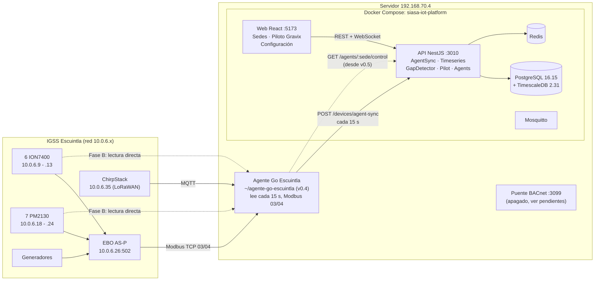
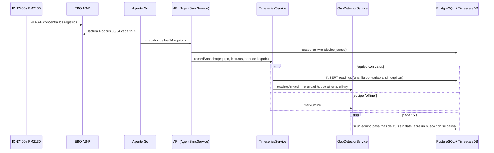

# Piloto Gravix: arquitectura y bitácora de implementación

Estado al 3 de noviembre de 2026. Sede piloto: **IGSS Escuintla**, servidor **192.168.70.4**.

Gravix es la propuesta para que las sedes de Telemetría 2 y 3 no dependan del AS-P ni de las
licencias EBO: el software de SIASA lee los medidores, guarda el historial, detecta los datos que
faltan y los recupera. El piloto lo prueba en Escuintla **en paralelo al AS-P**, por fases y sin
escribir nada en los equipos (Modbus solo funciones 03/04).

| Fase | Qué agrega | Estado |
| --- | --- | --- |
| **A. Historial** | Cada lectura se guarda con su hora en PostgreSQL + TimescaleDB y se registra cada hueco con su causa | **En producción desde el 03/11/2026** |
| **B. Lectura directa** | El agente lee cada medidor por su propia IP y compara contra el AS-P | **En prueba desde el 09/11/2026** con ANALIZADOR-1 y PM2130-1 (sección 9) |
| **C. Recuperación** | Rellenar huecos desde la memoria del ION7400 (recuperada) o por diferencia de contador (estimada) | Pendiente; hay que verificar antes en el equipo cómo se lee su memoria |

## 1. Arquitectura general

### Flujo de una lectura (Fase A)

Causas que registra el detector de huecos:

| Causa | Cuándo |
| --- | --- |
| El agente no reporta (agente, enlace o API sin servicio) | El agente de la sede no sincronizó en los últimos 45 s |
| El equipo no responde (AS-P o Modbus) | El agente sí reporta, pero marca el equipo "offline" |
| Sin lecturas nuevas del equipo | Cualquier otro caso |

## 2. Base de datos

- **Imagen propia** `siasa-postgres-timescale:16.15-2.31.0` ([docker/postgres/Dockerfile](../docker/postgres/Dockerfile)):
  la misma `postgres:16` Debian de antes más TimescaleDB, instalado desde el repositorio de Timescale.
  El paquete del repositorio de PostgreSQL es solo la parte "apache" y no permite compresión ni
  políticas automáticas; se comprobó con una prueba antes de elegir.
- **Mismo volumen de datos** (`siasa-iot-platform_postgres_data`): al ser la misma versión mayor (16) y
  la misma base Debian, no hubo que restaurar los 3.5 GB.
- `docker-compose.yml`: `build: docker/postgres` y `command: postgres -c shared_preload_libraries=timescaledb`.

Tablas nuevas (migración `20261103120000_add_timeseries_readings`):

| Tabla | Para qué | Detalles |
| --- | --- | --- |
| `readings` | Historial detallado | Hypertable de 1 día. Llave `(deviceId, metric, time)`: un reenvío nunca duplica. Columna `quality`: real / recuperada / estimada. Compresión automática a los 7 días |
| `reading_gaps` | Huecos por equipo | Inicio, fin (null si sigue abierto), causa y estado: open, closed, recovered, partial, estimated, unrecoverable |

También se aplicó `20261102120000_add_agent_configs` (configuración remota de los agentes).

Volumen observado: unas 1,150 filas por minuto en Escuintla (14 equipos), unos 400 MB al día antes
de comprimirse. Disco libre en el servidor: 300 GB.

## 3. API (NestJS)

Módulos nuevos:

| Módulo | Archivos | Qué hace |
| --- | --- | --- |
| `timeseries` | [timeseries.service.ts](../apps/api/src/timeseries/timeseries.service.ts), [gap-detector.service.ts](../apps/api/src/timeseries/gap-detector.service.ts), [pilot.service.ts](../apps/api/src/timeseries/pilot.service.ts), [pilot.controller.ts](../apps/api/src/timeseries/pilot.controller.ts) | Guarda el historial, detecta huecos y responde a la pestaña Piloto Gravix |
| `agents` | [apps/api/src/agents/](../apps/api/src/agents/) | Configuración remota de los Agente Go y búsqueda de equipos en la red de cada sede |

`AgentSyncService` llama a `TimeseriesService` en cada sync. Solo se guarda historial de equipos
**Modbus** (los de energía). Si el agente manda la misma lectura dos veces en menos de 20 s (sincroniza
y lee al mismo ritmo, sin coordinarse), la segunda no se guarda.

Endpoints nuevos:

| Método | Ruta | Quién | Descripción |
| --- | --- | --- | --- |
| GET | `/pilot/:buildingKey/devices` | usuarios | Equipos de energía de la sede: estado en vivo, huecos de 7 días, % de datos completos, conexión directa |
| GET | `/pilot/devices/:id/series?metric=&minutes=` | usuarios | Serie agrupada con `time_bucket` (unos 240 puntos) y los huecos de esa ventana |
| GET | `/pilot/devices/:id/gaps?days=` | usuarios | Huecos del equipo |
| PUT | `/pilot/devices/:id/connection` | admin | Guarda IP, puerto, ID Modbus, puente RS-485 y si se lee directo (`Device.metadata.directConnection`) |
| GET/PUT | `/agents/...` | ver [api.md](./api.md) | Configuración remota y búsqueda de equipos |

## 4. Web

Pestaña **Piloto Gravix** ([Gravix.tsx](../apps/web/src/routes/Gravix.tsx)), con el diseño de la maqueta aprobada:

- **Barra de fases fija:** avance real de la sede. Tocar una fase filtra la lista.
- **Indicadores:** equipos con historial, huecos pendientes de 7 días, % de datos completos y último reporte del agente.
- **Panel izquierdo:** equipos agrupados por fase, filtro por tipo, buscador y vista **Por red** (qué equipos comparten IP o van por RS-485).
- **Panel derecho** (detalle):
  - **Equipo y métricas:** el equipo en 3D ([DeviceArt.tsx](../apps/web/src/components/gravix/DeviceArt.tsx)), con sus botones funcionando sobre las lecturas reales.
    - ION7400: menú con Resumen, Voltaje, Corriente, Potencia, Fasores, Calidad y Demanda.
    - Medidor de circuito (frente EM6400NG+): VL-N, VL-L, I, demanda y reloj.
    - Generador: Motor, Eléctrico, Batería y Alarmas.
    - Además: gráfica de la última hora con los huecos marcados y el avance del equipo en el piloto.
  - **Huecos:** mapa de 7 días, lista con causa y duración. "Recuperar" queda bloqueado hasta la Fase C.
  - **Conexión:** formulario de lectura directa (IP, puerto, ID, puente RS-485, intervalo). Solo lectura 03/04, fijo.
- **Pantalla Fasores:** las magnitudes son reales, pero el AS-P no manda ángulos. Los voltajes se dibujan en su ángulo nominal y cada corriente se desfasa `acos(|FP|)` de su fase. La pantalla lo indica. Los ángulos medidos llegarán con la lectura directa.

Pestaña **Configuración** ([AgentConfig.tsx](../apps/web/src/routes/AgentConfig.tsx)): protocolos e IP de
cada agente editables desde la web, y búsqueda de equipos en la red de la sede. Ya está desplegada,
pero solo la aplica un agente 0.5 o posterior.

Los estilos de la pestaña Piloto Gravix están en [gravix.css](../apps/web/src/components/gravix/gravix.css):
todas las reglas bajo `.gx` y las animaciones con prefijo `gx-`, para no tocar el resto de la web.

## 5. Agente Go 0.5 (código listo, sin compilar)

- **Configuración remota:** consulta `GET /agents/:sede/control` cada 5 s y aplica los cambios sin reiniciar. Guarda una copia en `dataDir` por si la API no responde.
- **Búsqueda de equipos:** Modbus (lectura 03 de 1 registro por ID), BACnet (Who-Is a través del puente) y prueba de conexión a brokers.
- No está compilado ni desplegado porque **Go no está instalado** en la PC de desarrollo. El agente de Escuintla sigue en la 0.4.

## 6. Bitácora del despliegue (03/11/2026, servidor 192.168.70.4)

| Hora (UTC) | Paso |
| --- | --- |
| — | Acceso por llave SSH (`~/.ssh/id_ed25519` de la PC de desarrollo) en `~/.ssh/authorized_keys` del usuario `api` |
| — | Se comparó cada archivo del servidor contra el repositorio, ignorando los finales de línea. Solo `Devices.tsx` tenía un cambio hecho en el servidor (pestañas en dos líneas en celular), que ya estaba incluido en la versión nueva |
| 21:31 | Respaldos: `~/backups/siasa_iot-20261103-2131.dump` (377 MB, 17 tablas, verificado) y `~/backups/siasa-iot-platform-code-20261103-2131.tgz` |
| 21:33 | Código copiado (`~/deploy-fasea.tgz`) y la imagen de PostgreSQL cargada con `docker save … \| ssh … docker load` |
| 21:35 | API detenida; PostgreSQL arrancado con la imagen nueva sobre el mismo volumen. Datos verificados: 321 dispositivos, 4,530,216 lecturas históricas |
| 21:37 | API y web construidas y levantadas. Migraciones `add_agent_configs` y `add_timeseries_readings` aplicadas. Primeras lecturas en `readings` |
| 21:44 | Intento de reiniciar el puente BACnet (ver pendientes); se dejó apagado, como estaba |
| 22:00 | Datos de conexión directa cargados para 12 equipos de Escuintla, con la lectura directa **apagada** |
| 22:06 | Verificación: 34,663 lecturas de 14 equipos, 0 huecos, rutas nuevas responden (401 sin sesión) |

La API estuvo detenida unos 4 minutos (21:33–21:37). El agente reintenta solo.

### Vuelta atrás

- **Web/API:** restaurar `~/backups/siasa-iot-platform-code-20261103-2131.tgz` y `docker compose up -d --build api web`.
- **Base de datos:** el volumen ya tiene la extensión y las tablas de TimescaleDB, así que **no** basta con volver a la imagen `postgres:16`. O se mantiene la imagen nueva, o se restaura el respaldo en un volumen nuevo con `postgres:16`:
  `pg_restore -U siasa -d siasa_iot --clean ~/backups/siasa_iot-20261103-2131.dump`.

## 7. Datos de conexión directa cargados (Escuintla)

| Equipo | IP | ID Modbus | Nota |
| --- | --- | --- | --- |
| ANALIZADOR-2 | 10.0.6.9 | 255 (por defecto) | Es el único con IP: hace de puerta (gateway) hacia el cable RS-485 |
| ANALIZADOR-1 | 10.0.6.9 | 21 | Detrás del ANALIZADOR-2 por RS-485 |
| Generador Planta Hospital | 10.0.6.9 | 2 | Controlador detrás del ANALIZADOR-1 por RS-485 (mismo cable) |
| ANALIZADOR-3 a 6 | 10.0.6.10 – .13 | 255 (por defecto) | |
| PM2130-1 a 7 | 10.0.6.18 – .24 | 2 | La foto del equipo dice EM6400NG+: confirmar el modelo |

Conexión física: red → **ANALIZADOR-2** (10.0.6.9) → cable Modbus RS-485 → **ANALIZADOR-1** → **generador de planta**.
El ID de la consulta decide quién contesta: 255 = el propio ANALIZADOR-2, 21 = ANALIZADOR-1, 2 = generador.
El "Generador Módulos" (bloque 5743 del AS-P) no se lee directo todavía.

## 8. Pendientes

1. **Agente Go 0.5:** instalar Go, compilar, probar y desplegar en Escuintla. Habilita la configuración desde la web y la búsqueda de equipos.
2. **Hora de cada lectura:** hoy se guarda la hora de llegada a la API. El agente debe mandar la hora en que leyó, y guardar en disco lo que no pudo enviar.
3. **Fase B:** mapa de registros propio del ION7400 y del medidor de circuito, verificado contra el equipo (solo 03/04, con tu confirmación equipo por equipo). También confirmar los IDs "por defecto", el ANALIZADOR-2 y el generador, y el modelo PM2130 o EM6400NG+.
4. **Fase C:** verificar cómo se lee por Modbus la memoria (data recorder) del ION7400 antes de programar la recuperación.
5. **Puente BACnet (aires de TEC3):** caído desde el 23/10/2026. No arranca porque el contenedor `node-api` (sistema `node-postgres-docker`) publica el puerto UDP 47808. Hay que decidir si se le quita ese puerto.
6. **Retención:** decidir cuánto tiempo se guarda el detalle de 15 s (hoy no se borra nada; solo se comprime).
7. **Seguridad:** cambiar la clave del usuario `api` del servidor, que se compartió por chat.
8. **Git:** los cambios no están en un commit; el servidor se actualizó copiando archivos.

## 9. Fase B: lectura directa en prueba (09/11/2026)

### Cómo está armada (sin tocar producción)

| Pieza | Detalle |
| --- | --- |
| Agente de prueba | `~/agente-go-escuintla-directo` (versión 0.5), sede `igss-escuintla-directo`, API key propia "Agente Escuintla lectura directa (prueba Gravix)". **Eventos apagados**. Desde el 13/11/2026: versión **0.5.3** (reconoce ION7400/PM2130/generador al buscar) y `remoteConfig: true` (su config.yaml se subió a la API como v1; se edita en la web, menú **Equipos**). Lee cada **30 s**, `readDelayMs` 100, una conexión fija por medidor |
| Equipos | Desde el 09/11 13:08: ANALIZADOR-1 (10.0.6.9, ID 21) y PM2130-1 (10.0.6.18, ID 2). Desde el 09/11 16:42 (hora de Guatemala): también ANALIZADOR-3 a 6 (10.0.6.10-.13, **ID 255**) y PM2130-2 a 7 (10.0.6.19-.24, ID 2). Desde el 10/11 13:27 (versión 0.5.2): ANALIZADOR-2 (10.0.6.9, **ID 255**) y Generador Planta Hospital (10.0.6.9, **ID 2**, perfil `generador-directo`). **14 de 14 equipos** |
| Generador directo | Registros 4770-4806 del controlador (los mismos que lee el AS-P), int32 CDAB. Verificado en espera: refrigerante y batería en décimas (106 → 10.6 °C, 274 → 27.4 V; el AS-P los republica redondeados, 11 y 27). Factor de potencia float32 CDAB (1.0; el EBO lo lee como entero ×0.001 y muestra 16.26). La escala de kW, kVA, Hz, RPM, carga, aceite y combustible se confirma en la próxima prueba del generador (con el motor apagado valen 0) |
| Errores del AS-P vistos | Flicker y THD de corriente A de los ION7400; **corriente A del ANALIZADOR-2 en 0** (directo: ~538 A) |
| ID de los ION7400 "por defecto" | Se probaron 4 IDs leyendo solo la frecuencia. **ID 255** ("este mismo equipo" en Modbus TCP) responde en los cuatro y no se reenvía al RS-485. Con 1, 100 o 21 solo responde ANALIZADOR-4; los demás no contestan (probablemente lo reenvían a su puerto serie), así que no se siguió probando |
| Agente actual | `~/agente-go-escuintla` sigue leyendo el AS-P **sin cambios** |
| Arranque | `start.sh` con reinicio automático. **No está en el crontab**: después de reiniciar el servidor hay que arrancarlo a mano. Los comandos para detenerlo están en el mismo `start.sh` |
| Comparativo | `GET /pilot/devices/:id/compare?minutes=` y pestaña **Piloto Gravix → equipo → Directo vs AS-P** |

Los dos caminos se emparejan por **nombre del equipo**: el de la sede `igss-escuintla` contra el de `igss-escuintla-directo`.

### Mapa de registros verificado contra el equipo

Tomado de la exportación de puntos del AS-P y verificado con una lectura de solo lectura (función 03), comparando contra el AS-P en el mismo instante:

- **Dirección Modbus = registro − 1.**
- **float32 en orden ABCD.** Es lo que EcoStruxure llama "32 bit real swapped".
- **ION7400:** potencias en W/VA (se pasan a kW/kVA) y THD como fracción (se pasa a %). Acepta bloques grandes.
- **PM2130:** potencias ya en kW y THD ya en %. Energías en int64 ABCD, en Wh. **Rechaza (excepción 3) toda consulta que no empiece justo en un valor o que incluya registros sin definir**, así que se lee valor por valor.
- **Valor NaN = no aplica** (por ejemplo, la fase C del PM2130-1). Se omite; el AS-P lo convierte en 0.

Perfiles en `apps/Agente_Go/internal/discovery/modbussource/direct.go` (`ion7400-directo`, `pm2130-directo`), con pruebas en `direct_test.go`.

Prueba de red: los 12 medidores (10.0.6.9-.13 y .18-.24) responden en el puerto 502 desde 192.168.70.4, en 3-9 ms.

### Primeros resultados (1 hora)

| Equipo | Métricas comparadas | Dentro de tolerancia | Notas |
| --- | --- | --- | --- |
| ANALIZADOR-1 | 37 | 30/37, promedio 88 % | Voltajes, frecuencia, FP, THD de voltaje, demandas pico y ATS coinciden. Corriente y potencia, ±1-2 %, por el ciclo del AS-P |
| PM2130-1 | 7 (+28 que **solo** se obtienen leyendo directo) | 6/7, promedio 97 % | Corriente A ±2 % (carga chica que varía rápido) |

**Hallazgos:**

1. **El AS-P llega alrededor de 1 minuto atrasado:** en la demanda del PM2130-1, cada cambio aparece primero en la lectura directa.
2. **Datos que el camino del AS-P entrega mal:**
   - **Flicker Pst** del ION7400: el AS-P lo republica con una escala variable, y sale 0.05 contra 0.46 real;
   - **THD de corriente A** del ANALIZADOR-1: por el AS-P llega **0**, directo ≈5.9 %.
3. **Métricas nuevas del PM2130 con lectura directa:** potencia activa, reactiva y aparente por fase, factor de potencia, promedios, THD y **energías (kWh, kVArh, kVAh)**. El servidor Modbus del AS-P solo republica 11 valores.

Con los 12 equipos (primeros 6 minutos): voltaje ≤0.11 %, frecuencia ≤0.007 Hz, potencia 0.02-3 %. La corriente de los PM2130 varía hasta ~5 % porque son cargas chicas que cambian entre la lectura del AS-P y la directa.

### Respaldo en disco del agente (09/11/2026)

El agente de prueba guarda en disco las lecturas que no pudo entregar y las reenvía al volver la API, **con la hora real de lectura**:

- **Agente:** cada equipo Modbus lleva `readAt` (la hora en que se leyó). Si el envío falla, sus lecturas se escriben en `data/backlog/AAAAMMDDhhmm.jsonl`: un archivo por bloque de 5 minutos, nada en memoria. El tope es de 3 días; si se supera, se descartan los bloques más viejos y queda en el log. Al volver la API se envían 4 bloques por ciclo, el más viejo primero, y se borran al confirmarse ([internal/backlog](../apps/Agente_Go/internal/backlog/backlog.go)).
- **API:** guarda el historial con `readAt` si viene, y con la hora de llegada si no (agentes 0.4). Las lecturas atrasadas (`backlog`) se guardan con su hora sin duplicar, y el hueco se marca **recovered** si ya no queda ningún salto de más de 90 s, o **partial** si se llenó solo una parte (`GapDetectorService.reconcile`).
- **Prueba:** 4 minutos con la API inalcanzable **solo para el agente de prueba** (dirección cambiada; la API real y el agente de producción siguieron normales). El agente guardó 84 lecturas (100 KB); al volver reenvió 3,115 valores y los 12 huecos quedaron **recovered**, con lecturas cada ~30 s dentro de la caída. Los bloques se reenviaron incluso después de reiniciar el agente.
- **Uso de recursos:** RAM de cada agente 10-14 MB; la caída de 4 min ocupó 100 KB, lo que da ~36 MB por día con 12 equipos (tope de 3 días ≈ 110 MB).

### Resultado del comparativo (09/11 13:08 – 12/11 16:00, hora de Guatemala)

Consulta de solo lectura sobre `readings`. Se usaron solo los minutos que tienen dato de los dos caminos, con las
tolerancias de `toleranceFor`, en promedios de 1 y de 15 minutos.

| Qué se midió | Resultado |
| --- | --- |
| Datos | 14 equipos por camino; unos 2.3 millones de valores; 3,033-4,492 minutos pareados por equipo |
| Disponibilidad directa | 99.8-100 % de los minutos. Huecos "equipo no responde" de 1-5 min, de 1 a 11 min en total por equipo en 3 días (el peor es ANALIZADOR-3, el 11/11 de 16:33 a 17:26). El corte del 10/11 a las 07:56 afectó a los dos caminos |
| Voltaje | 99.6-100 % dentro de ±1 %; sesgo ≤0.02 % |
| Frecuencia | 100 % dentro de ±0.05 Hz |
| THD de voltaje | 99-100 % dentro de ±0.5 |
| Demandas pico, estado y conteo del ATS | 100 % iguales |
| Potencia y corriente de los ION7400 (15 min) | 97-100 % dentro de ±3 %, sesgo ≤0.2 %. En 1 min, 55-87 %, porque cada camino lee en un instante distinto. ANALIZADOR-4 fase B: 88-90 % (carga de unos 2 kW) |
| Corriente de los PM2130 (15 min) | 61-99 % dentro de ±3 %, sesgo ≤0.4 % (PM2130-6: −1.5 %). Son cargas de 4 a 33 A que cambian rápido. La demanda total coincide 95-100 % |
| Retraso del AS-P | Hasta 1 minuto. En ANALIZADOR-3 la diferencia baja de 15.4 % a 2.8 % al correr el directo 1 minuto |
| Frescura | Por el AS-P, 23-29 % de los voltajes de ANALIZADOR-1/2 se repiten igual en la siguiente lectura (hasta 2 min sin cambiar). La corriente del PM2130-2 llegó a quedar fija 16 min. Directo: 0.1-0.3 % |

**Datos que el AS-P entrega mal (la lectura directa los corrige):**
- THD de corriente fase A: 0 en los 6 ION7400. Directo: 7.3-22.8 %.
- Corriente A del ANALIZADOR-2: 0, aunque la fase A tiene 47.8 kW. Directo: 388 A.
- Flicker Pst de ANALIZADOR-1/2/3: 0.06-0.13. Directo: 0.40-0.50.
- Factor de potencia del generador: 16. Directo: 1.0. Batería redondeada: 27 contra 27.4 V.
- 10/11 a las 07:56: el AS-P publicó valores basura del generador (65535, 4252041233, −32769) y quedaron guardados como lecturas.

**Por confirmar en la pantalla del medidor:** el THD de corriente de las fases B y C no coincide. En ANALIZADOR-5, el AS-P
da 2.2 y el directo 21.4; en ANALIZADOR-4 fase B, 3.6 contra 14.6. En los demás, el directo da 10-50 % más.

**Fallas de la lectura directa por corregir:**
1. ANALIZADOR-3 y 4 reportan estado y conteos del ATS (registros 411-414) con valores sin sentido (−37.9 y −22307),
   porque esos medidores no tienen esas entradas. Hay que quitarlos de su perfil.
2. El factor de potencia de los PM2130 sale mayor a 1 (1.05-1.42). Probablemente el registro usa la codificación de
   4 cuadrantes de Schneider (rango −2 a 2), pero hay que verificarlo contra la pantalla antes de convertirlo.
3. Generador: kW, kVA, Hz, RPM, carga, aceite y combustible no se han podido verificar, porque el motor no arrancó
   durante la prueba.
4. El agente de prueba no está en el crontab. La configuración remota quedó activa el 13/11 (versión 0.5.3).

**Conclusión:** la lectura directa es técnicamente viable para reemplazar al AS-P como fuente de datos. Iguala al AS-P en
lo básico (voltaje, frecuencia, potencia y demanda), es más fresca y tiene más datos. Antes de pasarla a producción hay
que corregir los puntos 1-4 y confirmar el THD de corriente. La recuperación desde la memoria del ION7400 (Fase C)
sigue pendiente.

### Armónicos del ION7400 (13/11/2026, agente 0.5.4)

| Dato | Detalle |
| --- | --- |
| Registros (exportación de puntos del AS-P) | Armónico n = inicio + 6·(n−1). Voltaje A-N/B-N/C-N: 22878 / 23266 / 23654. Corriente A/B/C: 24430 / 24818 / 25206. float32 ABCD, magnitud en V o A (H1 = fundamental). El registro +2 de cada armónico es su ángulo (no se usa todavía) |
| Verificación | Lectura de solo lectura en ANALIZADOR-1: el THD calculado con el espectro = THD del medidor (5.76 %). Después, con lo guardado: ANALIZADOR-1 a 6 iguales (diferencia ≤0.03 puntos) |
| Orden máximo | ANALIZADOR-1 a 4: hasta el 63. **ANALIZADOR-5 y 6: hasta el 31** (desde el 32 el medidor responde excepción 2). El agente detecta el límite solo |
| Frecuencia | Cada 10 min (intervalo IEC 61000-4-30). El agente reenvía el último espectro en cada sync con `harm_read_at`; la API lo guarda una vez con esa hora (`TimeseriesService.recordHarmonics`) |
| Volumen | 6 ION × hasta 378 valores × 144 por día ≈ 290 mil filas por día |
| API | `GET /pilot/devices/:id/espectro?at=ISO` (último espectro hasta esa hora). El comparativo directo vs AS-P ignora `harm_*` |
| Web | Pantalla del ION → **Armónicos** (THD por fase) y **Espectro** (V1 H2-H31). Debajo, panel con "Espectro" (V1-V3, I1-I3, THD par/impar, % de la fundamental, otra fecha y hora, clic = tendencia del armónico) y "THD en el tiempo" |
| Curva ITI (CBEMA) | **No disponible por Modbus**: la exportación solo trae contadores de perturbaciones (13598 corriente, 13600 voltaje), no cada evento con su % y duración |

### Pendiente para cerrar la Fase B

- Dejar correr varios días y revisar el comparativo en **24 horas** y **7 días**.
- Confirmar en el AS-P que ANALIZADOR-1 y PM2130-1 **no marcan fallas de comunicación** desde el 09/11/2026 a las 19:08 UTC (13:08 en Guatemala).
- Confirmar la escala de los puntos del generador cuando arranque (prueba semanal), en la pestaña **Directo vs AS-P**.
- Confirmar los nombres de los THD de voltaje del PM2130 en los registros 21322, 21328 y 21338 (columna NAME completa de la exportación).

## 10. Otros cambios de esta etapa

- Los procedimientos (skills) pasaron a [docs/procedimientos/](./procedimientos/). `.agents/skills/` (Codex) y `.claude/skills/` (Claude Code) solo apuntan a esos documentos.
- [database.md](./database.md) y [deployment.md](./deployment.md) se actualizaron con TimescaleDB y el procedimiento de despliegue de la imagen.
